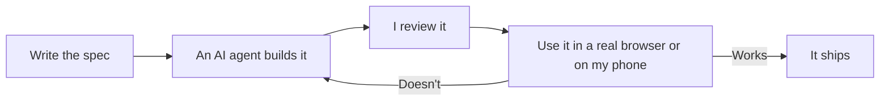

I build local-first apps and web products in Bengaluru. My work lives at [mmoptibuilds.com](https://mmoptibuilds.com). I'm @mmoptibuilds on [X](https://x.com/mmoptibuilds), [Instagram](https://www.instagram.com/mmoptibuilds) and [Threads](https://www.threads.net/@mmoptibuilds). If you need a website or hardware for a small business, email me at [hello@mmoptibuilds.com](mailto:hello@mmoptibuilds.com).

## About

The name at the top cycles through five languages. <ruby>हिन्दी<rt>Hindi</rt></ruby> and <ruby>اردو<rt>Urdu</rt></ruby> are my first, I speak English and <ruby>ಕನ್ನಡ<rt>Kannada</rt></ruby>, and I'm learning <ruby>日本語<rt>Japanese</rt></ruby>.

I'm a BCA student and I run mmoptibuilds. It has two sides: Studio builds websites and web apps, and Systems handles custom PCs, workstations and hardware for small businesses.

On software projects I write the spec and decide how things should look and behave. Nothing counts as done until I've used it in a real browser or on my own phone.

## Work

<a href="https://github.com/mmoptibuilds-commits/notes-app"></a>

Offline-first notes for Android and Linux. Notes are encrypted on the device and sync directly between your own devices over Wi-Fi, with no account or server.

<a href="https://github.com/mmoptibuilds-commits/markdown-reader-extension"></a>

A browser extension that opens Markdown from the web or your disk and renders it properly, maths and Mermaid diagrams included. Runs in Chrome, Edge, Vivaldi and Firefox.

<a href="https://github.com/mmoptibuilds-commits/coldharbour"></a>

A product site for a made-up company that monitors temperatures on clinical shipments. The company and its data are fictional. The site runs on Next.js and PostgreSQL. [Live demo](https://coldharbour.mmoptibuilds.com).

<a href="https://github.com/mmoptibuilds-commits/mmoptibuilds-portfolio-yin-yang"></a>

The business site for Studio and Systems, with an owner console for handling enquiries. [Visit the site](https://mmoptibuilds.com).

<a href="https://github.com/mmoptibuilds-commits/mmoptibuilds-upload-portal"></a>

How clients send me files. I create the accounts, uploads pick up where they left off if the connection drops, and files end up in Google Drive.

<a href="https://github.com/mmoptibuilds-commits/web-dash"></a>

A desktop that runs in the browser, with windows, widgets and offline storage. You can install it like an app.

[Portfolio Setup](https://github.com/mmoptibuilds-commits/portfolio-setup) is the written-down version of how I run projects with AI agents.

## Tools


<details>
<summary>By area</summary>

| Area | What I use |
| --- | --- |
| Web | Next.js, React, TypeScript, Tailwind CSS, Vite |
| Apps | Flutter and Dart, browser extensions with WXT |
| Data | PostgreSQL, Drizzle, Supabase, SQLite, Dexie |
| Testing | Playwright, Vitest, axe |
| Hosting | Vercel, Cloudflare, Docker, Tailscale, my own Linux machines at home |
| AI | Claude Code, Codex, Gemini, OpenCode, Ollama, MCP |

</details>

## How I work

- I start from what the person using it needs to get done, and only add complexity when that needs it.
- I use AI coding agents heavily. I write the spec, review what they produce, and decide what ships.
- I test on real browsers and devices. Notes was checked on my phone and laptop before release.
- When something simple works as well as something clever, I pick the simple one.



## Right now

- Working on Notes. The next step is testing the in-app updater against a real published release.
- Building a new business website for mmoptibuilds.

## Contact

<a href="mailto:hello@mmoptibuilds.com"></a>

<details>
<summary>The symbol from my site, in 3D</summary>

Drag to rotate it.

<!-- stl:start -->
```stl
solid yinyang
facet normal 0 0 -1
outer loop
vertex 98.5 17.4 0
vertex 100 0 0
vertex 98.5 -17.4 0
endloop
endfacet
facet normal 0 0 -1
outer loop
vertex 94 34.2 0
vertex 98.5 17.4 0
vertex 98.5 -17.4 0
endloop
endfacet
facet normal 0 0 -1
outer loop
vertex 86.6 50 0
vertex 94 34.2 0
vertex 98.5 -17.4 0
endloop
endfacet
facet normal 0 0 -1
outer loop
vertex 76.6 64.3 0
vertex 86.6 50 0
vertex 98.5 -17.4 0
endloop
endfacet
facet normal 0 0 -1
outer loop
vertex 64.3 76.6 0
vertex 76.6 64.3 0
vertex 98.5 -17.4 0
endloop
endfacet
facet normal 0 0 -1
outer loop
vertex 50 86.6 0
vertex 64.3 76.6 0
vertex 98.5 -17.4 0
endloop
endfacet
facet normal 0 0 -1
outer loop
vertex 34.2 94 0
vertex 50 86.6 0
vertex 98.5 -17.4 0
endloop
endfacet
facet normal 0 0 -1
outer loop
vertex 17.4 98.5 0
vertex 34.2 94 0
vertex 98.5 -17.4 0
endloop
endfacet
facet normal 0 0 -1
outer loop
vertex 0 100 0
vertex 17.4 98.5 0
vertex 98.5 -17.4 0
endloop
endfacet
facet normal 0 0 -1
outer loop
vertex -17.4 98.5 0
vertex 0 100 0
vertex 98.5 -17.4 0
endloop
endfacet
facet normal 0 0 -1
outer loop
vertex -34.2 94 0
vertex -17.4 98.5 0
vertex 98.5 -17.4 0
endloop
endfacet
facet normal 0 0 -1
outer loop
vertex -50 86.6 0
vertex -34.2 94 0
vertex 98.5 -17.4 0
endloop
endfacet
facet normal 0 0 -1
outer loop
vertex -64.3 76.6 0
vertex -50 86.6 0
vertex 98.5 -17.4 0
endloop
endfacet
facet normal 0 0 -1
outer loop
vertex -76.6 64.3 0
vertex -64.3 76.6 0
vertex 98.5 -17.4 0
endloop
endfacet
facet normal 0 0 -1
outer loop
vertex -86.6 50 0
vertex -76.6 64.3 0
vertex 98.5 -17.4 0
endloop
endfacet
facet normal 0 0 -1
outer loop
vertex -94 34.2 0
vertex -86.6 50 0
vertex 98.5 -17.4 0
endloop
endfacet
facet normal 0 0 -1
outer loop
vertex -98.5 17.4 0
vertex -94 34.2 0
vertex 98.5 -17.4 0
endloop
endfacet
facet normal 0 0 -1
outer loop
vertex -100 0 0
vertex -98.5 17.4 0
vertex 98.5 -17.4 0
endloop
endfacet
facet normal 0 0 -1
outer loop
vertex -98.5 -17.4 0
vertex -100 0 0
vertex 98.5 -17.4 0
endloop
endfacet
facet normal 0 0 -1
outer loop
vertex -94 -34.2 0
vertex -98.5 -17.4 0
vertex 98.5 -17.4 0
endloop
endfacet
facet normal 0 0 -1
outer loop
vertex -86.6 -50 0
vertex -94 -34.2 0
vertex 98.5 -17.4 0
endloop
endfacet
facet normal 0 0 -1
outer loop
vertex -76.6 -64.3 0
vertex -86.6 -50 0
vertex 98.5 -17.4 0
endloop
endfacet
facet normal 0 0 -1
outer loop
vertex -64.3 -76.6 0
vertex -76.6 -64.3 0
vertex 98.5 -17.4 0
endloop
endfacet
facet normal 0 0 -1
outer loop
vertex -50 -86.6 0
vertex -64.3 -76.6 0
vertex 98.5 -17.4 0
endloop
endfacet
facet normal 0 0 -1
outer loop
vertex -34.2 -94 0
vertex -50 -86.6 0
vertex 98.5 -17.4 0
endloop
endfacet
facet normal 0 0 -1
outer loop
vertex -17.4 -98.5 0
vertex -34.2 -94 0
vertex 98.5 -17.4 0
endloop
endfacet
facet normal 0 0 -1
outer loop
vertex 0 -100 0
vertex -17.4 -98.5 0
vertex 98.5 -17.4 0
endloop
endfacet
facet normal 0 0 -1
outer loop
vertex 17.4 -98.5 0
vertex 0 -100 0
vertex 98.5 -17.4 0
endloop
endfacet
facet normal 0 0 -1
outer loop
vertex 34.2 -94 0
vertex 17.4 -98.5 0
vertex 98.5 -17.4 0
endloop
endfacet
facet normal 0 0 -1
outer loop
vertex 50 -86.6 0
vertex 34.2 -94 0
vertex 98.5 -17.4 0
endloop
endfacet
facet normal 0 0 -1
outer loop
vertex 64.3 -76.6 0
vertex 50 -86.6 0
vertex 98.5 -17.4 0
endloop
endfacet
facet normal 0 0 -1
outer loop
vertex 76.6 -64.3 0
vertex 64.3 -76.6 0
vertex 98.5 -17.4 0
endloop
endfacet
facet normal 0 0 -1
outer loop
vertex 86.6 -50 0
vertex 76.6 -64.3 0
vertex 98.5 -17.4 0
endloop
endfacet
facet normal 0 0 -1
outer loop
vertex 94 -34.2 0
vertex 86.6 -50 0
vertex 98.5 -17.4 0
endloop
endfacet
facet normal 0 0 1
outer loop
vertex 98.5 -17.4 6
vertex 100 0 6
vertex 98.5 17.4 6
endloop
endfacet
facet normal 0 0 1
outer loop
vertex 98.5 -17.4 6
vertex 98.5 17.4 6
vertex 94 34.2 6
endloop
endfacet
facet normal 0 0 1
outer loop
vertex 98.5 -17.4 6
vertex 94 34.2 6
vertex 86.6 50 6
endloop
endfacet
facet normal 0 0 1
outer loop
vertex 98.5 -17.4 6
vertex 86.6 50 6
vertex 76.6 64.3 6
endloop
endfacet
facet normal 0 0 1
outer loop
vertex 98.5 -17.4 6
vertex 76.6 64.3 6
vertex 64.3 76.6 6
endloop
endfacet
facet normal 0 0 1
outer loop
vertex 98.5 -17.4 6
vertex 64.3 76.6 6
vertex 50 86.6 6
endloop
endfacet
facet normal 0 0 1
outer loop
vertex 98.5 -17.4 6
vertex 50 86.6 6
vertex 34.2 94 6
endloop
endfacet
facet normal 0 0 1
outer loop
vertex 98.5 -17.4 6
vertex 34.2 94 6
vertex 17.4 98.5 6
endloop
endfacet
facet normal 0 0 1
outer loop
vertex 98.5 -17.4 6
vertex 17.4 98.5 6
vertex 0 100 6
endloop
endfacet
facet normal 0 0 1
outer loop
vertex 98.5 -17.4 6
vertex 0 100 6
vertex -17.4 98.5 6
endloop
endfacet
facet normal 0 0 1
outer loop
vertex 98.5 -17.4 6
vertex -17.4 98.5 6
vertex -34.2 94 6
endloop
endfacet
facet normal 0 0 1
outer loop
vertex 98.5 -17.4 6
vertex -34.2 94 6
vertex -50 86.6 6
endloop
endfacet
facet normal 0 0 1
outer loop
vertex 98.5 -17.4 6
vertex -50 86.6 6
vertex -64.3 76.6 6
endloop
endfacet
facet normal 0 0 1
outer loop
vertex 98.5 -17.4 6
vertex -64.3 76.6 6
vertex -76.6 64.3 6
endloop
endfacet
facet normal 0 0 1
outer loop
vertex 98.5 -17.4 6
vertex -76.6 64.3 6
vertex -86.6 50 6
endloop
endfacet
facet normal 0 0 1
outer loop
vertex 98.5 -17.4 6
vertex -86.6 50 6
vertex -94 34.2 6
endloop
endfacet
facet normal 0 0 1
outer loop
vertex 98.5 -17.4 6
vertex -94 34.2 6
vertex -98.5 17.4 6
endloop
endfacet
facet normal 0 0 1
outer loop
vertex 98.5 -17.4 6
vertex -98.5 17.4 6
vertex -100 0 6
endloop
endfacet
facet normal 0 0 1
outer loop
vertex 98.5 -17.4 6
vertex -100 0 6
vertex -98.5 -17.4 6
endloop
endfacet
facet normal 0 0 1
outer loop
vertex 98.5 -17.4 6
vertex -98.5 -17.4 6
vertex -94 -34.2 6
endloop
endfacet
facet normal 0 0 1
outer loop
vertex 98.5 -17.4 6
vertex -94 -34.2 6
vertex -86.6 -50 6
endloop
endfacet
facet normal 0 0 1
outer loop
vertex 98.5 -17.4 6
vertex -86.6 -50 6
vertex -76.6 -64.3 6
endloop
endfacet
facet normal 0 0 1
outer loop
vertex 98.5 -17.4 6
vertex -76.6 -64.3 6
vertex -64.3 -76.6 6
endloop
endfacet
facet normal 0 0 1
outer loop
vertex 98.5 -17.4 6
vertex -64.3 -76.6 6
vertex -50 -86.6 6
endloop
endfacet
facet normal 0 0 1
outer loop
vertex 98.5 -17.4 6
vertex -50 -86.6 6
vertex -34.2 -94 6
endloop
endfacet
facet normal 0 0 1
outer loop
vertex 98.5 -17.4 6
vertex -34.2 -94 6
vertex -17.4 -98.5 6
endloop
endfacet
facet normal 0 0 1
outer loop
vertex 98.5 -17.4 6
vertex -17.4 -98.5 6
vertex 0 -100 6
endloop
endfacet
facet normal 0 0 1
outer loop
vertex 98.5 -17.4 6
vertex 0 -100 6
vertex 17.4 -98.5 6
endloop
endfacet
facet normal 0 0 1
outer loop
vertex 98.5 -17.4 6
vertex 17.4 -98.5 6
vertex 34.2 -94 6
endloop
endfacet
facet normal 0 0 1
outer loop
vertex 98.5 -17.4 6
vertex 34.2 -94 6
vertex 50 -86.6 6
endloop
endfacet
facet normal 0 0 1
outer loop
vertex 98.5 -17.4 6
vertex 50 -86.6 6
vertex 64.3 -76.6 6
endloop
endfacet
facet normal 0 0 1
outer loop
vertex 98.5 -17.4 6
vertex 64.3 -76.6 6
vertex 76.6 -64.3 6
endloop
endfacet
facet normal 0 0 1
outer loop
vertex 98.5 -17.4 6
vertex 76.6 -64.3 6
vertex 86.6 -50 6
endloop
endfacet
facet normal 0 0 1
outer loop
vertex 98.5 -17.4 6
vertex 86.6 -50 6
vertex 94 -34.2 6
endloop
endfacet
facet normal 1 -0.3 0
outer loop
vertex 98.5 -17.4 6
vertex 94 -34.2 6
vertex 98.5 -17.4 0
endloop
endfacet
facet normal 1 -0.3 0
outer loop
vertex 98.5 -17.4 0
vertex 94 -34.2 6
vertex 94 -34.2 0
endloop
endfacet
facet normal 0.9 -0.4 0
outer loop
vertex 94 -34.2 6
vertex 86.6 -50 6
vertex 94 -34.2 0
endloop
endfacet
facet normal 0.9 -0.4 0
outer loop
vertex 94 -34.2 0
vertex 86.6 -50 6
vertex 86.6 -50 0
endloop
endfacet
facet normal 0.8 -0.6 0
outer loop
vertex 86.6 -50 6
vertex 76.6 -64.3 6
vertex 86.6 -50 0
endloop
endfacet
facet normal 0.8 -0.6 0
outer loop
vertex 86.6 -50 0
vertex 76.6 -64.3 6
vertex 76.6 -64.3 0
endloop
endfacet
facet normal 0.7 -0.7 0
outer loop
vertex 76.6 -64.3 6
vertex 64.3 -76.6 6
vertex 76.6 -64.3 0
endloop
endfacet
facet normal 0.7 -0.7 0
outer loop
vertex 76.6 -64.3 0
vertex 64.3 -76.6 6
vertex 64.3 -76.6 0
endloop
endfacet
facet normal 0.6 -0.8 0
outer loop
vertex 64.3 -76.6 6
vertex 50 -86.6 6
vertex 64.3 -76.6 0
endloop
endfacet
facet normal 0.6 -0.8 0
outer loop
vertex 64.3 -76.6 0
vertex 50 -86.6 6
vertex 50 -86.6 0
endloop
endfacet
facet normal 0.4 -0.9 0
outer loop
vertex 50 -86.6 6
vertex 34.2 -94 6
vertex 50 -86.6 0
endloop
endfacet
facet normal 0.4 -0.9 0
outer loop
vertex 50 -86.6 0
vertex 34.2 -94 6
vertex 34.2 -94 0
endloop
endfacet
facet normal 0.3 -1 0
outer loop
vertex 34.2 -94 6
vertex 17.4 -98.5 6
vertex 34.2 -94 0
endloop
endfacet
facet normal 0.3 -1 0
outer loop
vertex 34.2 -94 0
vertex 17.4 -98.5 6
vertex 17.4 -98.5 0
endloop
endfacet
facet normal 0.1 -1 0
outer loop
vertex 17.4 -98.5 6
vertex 0 -100 6
vertex 17.4 -98.5 0
endloop
endfacet
facet normal 0.1 -1 0
outer loop
vertex 17.4 -98.5 0
vertex 0 -100 6
vertex 0 -100 0
endloop
endfacet
facet normal -0.1 -1 0
outer loop
vertex 0 -100 6
vertex -17.4 -98.5 6
vertex 0 -100 0
endloop
endfacet
facet normal -0.1 -1 0
outer loop
vertex 0 -100 0
vertex -17.4 -98.5 6
vertex -17.4 -98.5 0
endloop
endfacet
facet normal -0.3 -1 0
outer loop
vertex -17.4 -98.5 6
vertex -34.2 -94 6
vertex -17.4 -98.5 0
endloop
endfacet
facet normal -0.3 -1 0
outer loop
vertex -17.4 -98.5 0
vertex -34.2 -94 6
vertex -34.2 -94 0
endloop
endfacet
facet normal -0.4 -0.9 0
outer loop
vertex -34.2 -94 6
vertex -50 -86.6 6
vertex -34.2 -94 0
endloop
endfacet
facet normal -0.4 -0.9 0
outer loop
vertex -34.2 -94 0
vertex -50 -86.6 6
vertex -50 -86.6 0
endloop
endfacet
facet normal -0.6 -0.8 0
outer loop
vertex -50 -86.6 6
vertex -64.3 -76.6 6
vertex -50 -86.6 0
endloop
endfacet
facet normal -0.6 -0.8 0
outer loop
vertex -50 -86.6 0
vertex -64.3 -76.6 6
vertex -64.3 -76.6 0
endloop
endfacet
facet normal -0.7 -0.7 0
outer loop
vertex -64.3 -76.6 6
vertex -76.6 -64.3 6
vertex -64.3 -76.6 0
endloop
endfacet
facet normal -0.7 -0.7 0
outer loop
vertex -64.3 -76.6 0
vertex -76.6 -64.3 6
vertex -76.6 -64.3 0
endloop
endfacet
facet normal -0.8 -0.6 0
outer loop
vertex -76.6 -64.3 6
vertex -86.6 -50 6
vertex -76.6 -64.3 0
endloop
endfacet
facet normal -0.8 -0.6 0
outer loop
vertex -76.6 -64.3 0
vertex -86.6 -50 6
vertex -86.6 -50 0
endloop
endfacet
facet normal -0.9 -0.4 0
outer loop
vertex -86.6 -50 6
vertex -94 -34.2 6
vertex -86.6 -50 0
endloop
endfacet
facet normal -0.9 -0.4 0
outer loop
vertex -86.6 -50 0
vertex -94 -34.2 6
vertex -94 -34.2 0
endloop
endfacet
facet normal -1 -0.3 0
outer loop
vertex -94 -34.2 6
vertex -98.5 -17.4 6
vertex -94 -34.2 0
endloop
endfacet
facet normal -1 -0.3 0
outer loop
vertex -94 -34.2 0
vertex -98.5 -17.4 6
vertex -98.5 -17.4 0
endloop
endfacet
facet normal -1 -0.1 0
outer loop
vertex -98.5 -17.4 6
vertex -100 0 6
vertex -98.5 -17.4 0
endloop
endfacet
facet normal -1 -0.1 0
outer loop
vertex -98.5 -17.4 0
vertex -100 0 6
vertex -100 0 0
endloop
endfacet
facet normal -1 0.1 0
outer loop
vertex -100 0 6
vertex -98.5 17.4 6
vertex -100 0 0
endloop
endfacet
facet normal -1 0.1 0
outer loop
vertex -100 0 0
vertex -98.5 17.4 6
vertex -98.5 17.4 0
endloop
endfacet
facet normal -1 0.3 0
outer loop
vertex -98.5 17.4 6
vertex -94 34.2 6
vertex -98.5 17.4 0
endloop
endfacet
facet normal -1 0.3 0
outer loop
vertex -98.5 17.4 0
vertex -94 34.2 6
vertex -94 34.2 0
endloop
endfacet
facet normal -0.9 0.4 0
outer loop
vertex -94 34.2 6
vertex -86.6 50 6
vertex -94 34.2 0
endloop
endfacet
facet normal -0.9 0.4 0
outer loop
vertex -94 34.2 0
vertex -86.6 50 6
vertex -86.6 50 0
endloop
endfacet
facet normal -0.8 0.6 0
outer loop
vertex -86.6 50 6
vertex -76.6 64.3 6
vertex -86.6 50 0
endloop
endfacet
facet normal -0.8 0.6 0
outer loop
vertex -86.6 50 0
vertex -76.6 64.3 6
vertex -76.6 64.3 0
endloop
endfacet
facet normal -0.7 0.7 0
outer loop
vertex -76.6 64.3 6
vertex -64.3 76.6 6
vertex -76.6 64.3 0
endloop
endfacet
facet normal -0.7 0.7 0
outer loop
vertex -76.6 64.3 0
vertex -64.3 76.6 6
vertex -64.3 76.6 0
endloop
endfacet
facet normal -0.6 0.8 0
outer loop
vertex -64.3 76.6 6
vertex -50 86.6 6
vertex -64.3 76.6 0
endloop
endfacet
facet normal -0.6 0.8 0
outer loop
vertex -64.3 76.6 0
vertex -50 86.6 6
vertex -50 86.6 0
endloop
endfacet
facet normal -0.4 0.9 0
outer loop
vertex -50 86.6 6
vertex -34.2 94 6
vertex -50 86.6 0
endloop
endfacet
facet normal -0.4 0.9 0
outer loop
vertex -50 86.6 0
vertex -34.2 94 6
vertex -34.2 94 0
endloop
endfacet
facet normal -0.3 1 0
outer loop
vertex -34.2 94 6
vertex -17.4 98.5 6
vertex -34.2 94 0
endloop
endfacet
facet normal -0.3 1 0
outer loop
vertex -34.2 94 0
vertex -17.4 98.5 6
vertex -17.4 98.5 0
endloop
endfacet
facet normal -0.1 1 0
outer loop
vertex -17.4 98.5 6
vertex 0 100 6
vertex -17.4 98.5 0
endloop
endfacet
facet normal -0.1 1 0
outer loop
vertex -17.4 98.5 0
vertex 0 100 6
vertex 0 100 0
endloop
endfacet
facet normal 0.1 1 0
outer loop
vertex 0 100 6
vertex 17.4 98.5 6
vertex 0 100 0
endloop
endfacet
facet normal 0.1 1 0
outer loop
vertex 0 100 0
vertex 17.4 98.5 6
vertex 17.4 98.5 0
endloop
endfacet
facet normal 0.3 1 0
outer loop
vertex 17.4 98.5 6
vertex 34.2 94 6
vertex 17.4 98.5 0
endloop
endfacet
facet normal 0.3 1 0
outer loop
vertex 17.4 98.5 0
vertex 34.2 94 6
vertex 34.2 94 0
endloop
endfacet
facet normal 0.4 0.9 0
outer loop
vertex 34.2 94 6
vertex 50 86.6 6
vertex 34.2 94 0
endloop
endfacet
facet normal 0.4 0.9 0
outer loop
vertex 34.2 94 0
vertex 50 86.6 6
vertex 50 86.6 0
endloop
endfacet
facet normal 0.6 0.8 0
outer loop
vertex 50 86.6 6
vertex 64.3 76.6 6
vertex 50 86.6 0
endloop
endfacet
facet normal 0.6 0.8 0
outer loop
vertex 50 86.6 0
vertex 64.3 76.6 6
vertex 64.3 76.6 0
endloop
endfacet
facet normal 0.7 0.7 0
outer loop
vertex 64.3 76.6 6
vertex 76.6 64.3 6
vertex 64.3 76.6 0
endloop
endfacet
facet normal 0.7 0.7 0
outer loop
vertex 64.3 76.6 0
vertex 76.6 64.3 6
vertex 76.6 64.3 0
endloop
endfacet
facet normal 0.8 0.6 0
outer loop
vertex 76.6 64.3 6
vertex 86.6 50 6
vertex 76.6 64.3 0
endloop
endfacet
facet normal 0.8 0.6 0
outer loop
vertex 76.6 64.3 0
vertex 86.6 50 6
vertex 86.6 50 0
endloop
endfacet
facet normal 0.9 0.4 0
outer loop
vertex 86.6 50 6
vertex 94 34.2 6
vertex 86.6 50 0
endloop
endfacet
facet normal 0.9 0.4 0
outer loop
vertex 86.6 50 0
vertex 94 34.2 6
vertex 94 34.2 0
endloop
endfacet
facet normal 1 0.3 0
outer loop
vertex 94 34.2 6
vertex 98.5 17.4 6
vertex 94 34.2 0
endloop
endfacet
facet normal 1 0.3 0
outer loop
vertex 94 34.2 0
vertex 98.5 17.4 6
vertex 98.5 17.4 0
endloop
endfacet
facet normal 1 -0.1 0
outer loop
vertex 100 0 6
vertex 98.5 -17.4 6
vertex 100 0 0
endloop
endfacet
facet normal 1 -0.1 0
outer loop
vertex 100 0 0
vertex 98.5 -17.4 6
vertex 98.5 -17.4 0
endloop
endfacet
facet normal 1 0.1 0
outer loop
vertex 98.5 17.4 6
vertex 100 0 6
vertex 98.5 17.4 0
endloop
endfacet
facet normal 1 0.1 0
outer loop
vertex 98.5 17.4 0
vertex 100 0 6
vertex 100 0 0
endloop
endfacet
facet normal 0 0 -1
outer loop
vertex 17.4 -98.5 6
vertex 0 -100 6
vertex -8.7 -99.2 6
endloop
endfacet
facet normal 0 0 -1
outer loop
vertex 34.2 -94 6
vertex 17.4 -98.5 6
vertex -8.7 -99.2 6
endloop
endfacet
facet normal 0 0 -1
outer loop
vertex 50 -86.6 6
vertex 34.2 -94 6
vertex -8.7 -99.2 6
endloop
endfacet
facet normal 0 0 -1
outer loop
vertex 64.3 -76.6 6
vertex 50 -86.6 6
vertex -8.7 -99.2 6
endloop
endfacet
facet normal 0 0 -1
outer loop
vertex 76.6 -64.3 6
vertex 64.3 -76.6 6
vertex -8.7 -99.2 6
endloop
endfacet
facet normal 0 0 -1
outer loop
vertex 86.6 -50 6
vertex 76.6 -64.3 6
vertex -8.7 -99.2 6
endloop
endfacet
facet normal 0 0 -1
outer loop
vertex 94 -34.2 6
vertex 86.6 -50 6
vertex -8.7 -99.2 6
endloop
endfacet
facet normal 0 0 -1
outer loop
vertex 98.5 -17.4 6
vertex 94 -34.2 6
vertex -8.7 -99.2 6
endloop
endfacet
facet normal 0 0 -1
outer loop
vertex 100 0 6
vertex 98.5 -17.4 6
vertex -8.7 -99.2 6
endloop
endfacet
facet normal 0 0 -1
outer loop
vertex 98.5 17.4 6
vertex 100 0 6
vertex -8.7 -99.2 6
endloop
endfacet
facet normal 0 0 -1
outer loop
vertex 94 34.2 6
vertex 98.5 17.4 6
vertex -8.7 -99.2 6
endloop
endfacet
facet normal 0 0 -1
outer loop
vertex 86.6 50 6
vertex 94 34.2 6
vertex -8.7 -99.2 6
endloop
endfacet
facet normal 0 0 -1
outer loop
vertex 76.6 64.3 6
vertex 86.6 50 6
vertex -8.7 -99.2 6
endloop
endfacet
facet normal 0 0 -1
outer loop
vertex 50 86.6 6
vertex 64.3 76.6 6
vertex 76.6 64.3 6
endloop
endfacet
facet normal 0 0 -1
outer loop
vertex 34.2 94 6
vertex 50 86.6 6
vertex 76.6 64.3 6
endloop
endfacet
facet normal 0 0 -1
outer loop
vertex 17.4 98.5 6
vertex 34.2 94 6
vertex 76.6 64.3 6
endloop
endfacet
facet normal 0 0 -1
outer loop
vertex 17.1 97 6
vertex 8.7 99.2 6
vertex 17.4 98.5 6
endloop
endfacet
facet normal 0 0 -1
outer loop
vertex 25 93.3 6
vertex 17.1 97 6
vertex 17.4 98.5 6
endloop
endfacet
facet normal 0 0 0
outer loop
vertex -8.7 -0.8 6
vertex 0 0 6
vertex 8.7 0.8 6
endloop
endfacet
facet normal 0 0 -1
outer loop
vertex -17.1 -3 6
vertex -8.7 -0.8 6
vertex 8.7 0.8 6
endloop
endfacet
facet normal 0 0 -1
outer loop
vertex -25 -6.7 6
vertex -17.1 -3 6
vertex 8.7 0.8 6
endloop
endfacet
facet normal 0 0 -1
outer loop
vertex -32.1 -11.7 6
vertex -25 -6.7 6
vertex 8.7 0.8 6
endloop
endfacet
facet normal 0 0 -1
outer loop
vertex -38.3 -17.9 6
vertex -32.1 -11.7 6
vertex 8.7 0.8 6
endloop
endfacet
facet normal 0 0 -1
outer loop
vertex -43.3 -25 6
vertex -38.3 -17.9 6
vertex 8.7 0.8 6
endloop
endfacet
facet normal 0 0 -1
outer loop
vertex -47 -32.9 6
vertex -43.3 -25 6
vertex 8.7 0.8 6
endloop
endfacet
facet normal 0 0 -1
outer loop
vertex -49.2 -41.3 6
vertex -47 -32.9 6
vertex 8.7 0.8 6
endloop
endfacet
facet normal 0 0 -1
outer loop
vertex -50 -50 6
vertex -49.2 -41.3 6
vertex 8.7 0.8 6
endloop
endfacet
facet normal 0 0 -1
outer loop
vertex -13.8 -47.6 6
vertex -14 -50 6
vertex -50 -50 6
endloop
endfacet
facet normal 0 0 -1
outer loop
vertex -13.2 -45.2 6
vertex -13.8 -47.6 6
vertex -50 -50 6
endloop
endfacet
facet normal 0 0 -1
outer loop
vertex -12.1 -43 6
vertex -13.2 -45.2 6
vertex -50 -50 6
endloop
endfacet
facet normal 0 0 -1
outer loop
vertex -10.7 -41 6
vertex -12.1 -43 6
vertex -50 -50 6
endloop
endfacet
facet normal 0 0 -1
outer loop
vertex -9 -39.3 6
vertex -10.7 -41 6
vertex -50 -50 6
endloop
endfacet
facet normal 0 0 -1
outer loop
vertex -7 -37.9 6
vertex -9 -39.3 6
vertex -50 -50 6
endloop
endfacet
facet normal 0 0 -1
outer loop
vertex -4.8 -36.8 6
vertex -7 -37.9 6
vertex -50 -50 6
endloop
endfacet
facet normal 0 0 -1
outer loop
vertex -50 -50 6
vertex -14 -50 6
vertex -13.8 -52.4 6
endloop
endfacet
facet normal 0 0 -1
outer loop
vertex -49.2 -58.7 6
vertex -50 -50 6
vertex -13.8 -52.4 6
endloop
endfacet
facet normal 0 0 -1
outer loop
vertex -47 -67.1 6
vertex -49.2 -58.7 6
vertex -13.8 -52.4 6
endloop
endfacet
facet normal 0 0 -1
outer loop
vertex -43.3 -75 6
vertex -47 -67.1 6
vertex -13.8 -52.4 6
endloop
endfacet
facet normal 0 0 -1
outer loop
vertex -38.3 -82.1 6
vertex -43.3 -75 6
vertex -13.8 -52.4 6
endloop
endfacet
facet normal 0 0 -1
outer loop
vertex -32.1 -88.3 6
vertex -38.3 -82.1 6
vertex -13.8 -52.4 6
endloop
endfacet
facet normal 0 0 -1
outer loop
vertex -25 -93.3 6
vertex -32.1 -88.3 6
vertex -13.8 -52.4 6
endloop
endfacet
facet normal 0 0 -1
outer loop
vertex -17.1 -97 6
vertex -25 -93.3 6
vertex -13.8 -52.4 6
endloop
endfacet
facet normal 0 0 -1
outer loop
vertex -8.7 -99.2 6
vertex -17.1 -97 6
vertex -13.8 -52.4 6
endloop
endfacet
facet normal 0 0 -1
outer loop
vertex 25 93.3 6
vertex 17.4 98.5 6
vertex 76.6 64.3 6
endloop
endfacet
facet normal 0 0 -1
outer loop
vertex 32.1 88.3 6
vertex 25 93.3 6
vertex 76.6 64.3 6
endloop
endfacet
facet normal 0 0 -1
outer loop
vertex 38.3 82.1 6
vertex 32.1 88.3 6
vertex 76.6 64.3 6
endloop
endfacet
facet normal 0 0 -1
outer loop
vertex 43.3 75 6
vertex 38.3 82.1 6
vertex 76.6 64.3 6
endloop
endfacet
facet normal 0 0 -1
outer loop
vertex 47 67.1 6
vertex 43.3 75 6
vertex 76.6 64.3 6
endloop
endfacet
facet normal 0 0 -1
outer loop
vertex 49.2 58.7 6
vertex 47 67.1 6
vertex 76.6 64.3 6
endloop
endfacet
facet normal 0 0 -1
outer loop
vertex 50 50 6
vertex 49.2 58.7 6
vertex 76.6 64.3 6
endloop
endfacet
facet normal 0 0 -1
outer loop
vertex 49.2 41.3 6
vertex 50 50 6
vertex 76.6 64.3 6
endloop
endfacet
facet normal 0 0 -1
outer loop
vertex 47 32.9 6
vertex 49.2 41.3 6
vertex 76.6 64.3 6
endloop
endfacet
facet normal 0 0 -1
outer loop
vertex 43.3 25 6
vertex 47 32.9 6
vertex 76.6 64.3 6
endloop
endfacet
facet normal 0 0 -1
outer loop
vertex 38.3 17.9 6
vertex 43.3 25 6
vertex 76.6 64.3 6
endloop
endfacet
facet normal 0 0 -1
outer loop
vertex -50 -50 6
vertex 8.7 0.8 6
vertex 17.1 3 6
endloop
endfacet
facet normal 0 0 -1
outer loop
vertex -4.8 -36.8 6
vertex -50 -50 6
vertex 17.1 3 6
endloop
endfacet
facet normal 0 0 -1
outer loop
vertex -2.4 -36.2 6
vertex -4.8 -36.8 6
vertex 17.1 3 6
endloop
endfacet
facet normal 0 0 -1
outer loop
vertex 0 -36 6
vertex -2.4 -36.2 6
vertex 17.1 3 6
endloop
endfacet
facet normal 0 0 -1
outer loop
vertex 2.4 -36.2 6
vertex 0 -36 6
vertex 17.1 3 6
endloop
endfacet
facet normal 0 0 -1
outer loop
vertex 4.8 -36.8 6
vertex 2.4 -36.2 6
vertex 17.1 3 6
endloop
endfacet
facet normal 0 0 -1
outer loop
vertex 7 -37.9 6
vertex 4.8 -36.8 6
vertex 17.1 3 6
endloop
endfacet
facet normal 0 0 -1
outer loop
vertex 9 -39.3 6
vertex 7 -37.9 6
vertex 17.1 3 6
endloop
endfacet
facet normal 0 0 -1
outer loop
vertex 10.7 -41 6
vertex 9 -39.3 6
vertex 17.1 3 6
endloop
endfacet
facet normal 0 0 -1
outer loop
vertex 12.1 -43 6
vertex 10.7 -41 6
vertex 17.1 3 6
endloop
endfacet
facet normal 0 0 -1
outer loop
vertex 13.2 -45.2 6
vertex 12.1 -43 6
vertex 17.1 3 6
endloop
endfacet
facet normal 0 0 -1
outer loop
vertex 13.8 -47.6 6
vertex 13.2 -45.2 6
vertex 17.1 3 6
endloop
endfacet
facet normal 0 0 -1
outer loop
vertex 14 -50 6
vertex 13.8 -47.6 6
vertex 17.1 3 6
endloop
endfacet
facet normal 0 0 -1
outer loop
vertex -8.7 -99.2 6
vertex -13.8 -52.4 6
vertex -13.2 -54.8 6
endloop
endfacet
facet normal 0 0 -1
outer loop
vertex 14 -50 6
vertex 17.1 3 6
vertex 25 6.7 6
endloop
endfacet
facet normal 0 0 -1
outer loop
vertex 13.8 -52.4 6
vertex 14 -50 6
vertex 25 6.7 6
endloop
endfacet
facet normal 0 0 -1
outer loop
vertex -8.7 -99.2 6
vertex -13.2 -54.8 6
vertex -12.1 -57 6
endloop
endfacet
facet normal 0 0 -1
outer loop
vertex 13.8 -52.4 6
vertex 25 6.7 6
vertex 32.1 11.7 6
endloop
endfacet
facet normal 0 0 -1
outer loop
vertex 13.2 -54.8 6
vertex 13.8 -52.4 6
vertex 32.1 11.7 6
endloop
endfacet
facet normal 0 0 -1
outer loop
vertex -8.7 -99.2 6
vertex -12.1 -57 6
vertex -10.7 -59 6
endloop
endfacet
facet normal 0 0 -1
outer loop
vertex 13.2 -54.8 6
vertex 32.1 11.7 6
vertex 38.3 17.9 6
endloop
endfacet
facet normal 0 0 -1
outer loop
vertex -8.7 -99.2 6
vertex -10.7 -59 6
vertex -9 -60.7 6
endloop
endfacet
facet normal 0 0 -1
outer loop
vertex 13.2 -54.8 6
vertex 38.3 17.9 6
vertex 76.6 64.3 6
endloop
endfacet
facet normal 0 0 -1
outer loop
vertex 12.1 -57 6
vertex 13.2 -54.8 6
vertex 76.6 64.3 6
endloop
endfacet
facet normal 0 0 -1
outer loop
vertex -8.7 -99.2 6
vertex -9 -60.7 6
vertex -7 -62.1 6
endloop
endfacet
facet normal 0 0 -1
outer loop
vertex 12.1 -57 6
vertex 76.6 64.3 6
vertex -8.7 -99.2 6
endloop
endfacet
facet normal 0 0 -1
outer loop
vertex 10.7 -59 6
vertex 12.1 -57 6
vertex -8.7 -99.2 6
endloop
endfacet
facet normal 0 0 -1
outer loop
vertex 9 -60.7 6
vertex 10.7 -59 6
vertex -8.7 -99.2 6
endloop
endfacet
facet normal 0 0 -1
outer loop
vertex 7 -62.1 6
vertex 9 -60.7 6
vertex -8.7 -99.2 6
endloop
endfacet
facet normal 0 0 -1
outer loop
vertex 4.8 -63.2 6
vertex 7 -62.1 6
vertex -8.7 -99.2 6
endloop
endfacet
facet normal 0 0 -1
outer loop
vertex 2.4 -63.8 6
vertex 4.8 -63.2 6
vertex -8.7 -99.2 6
endloop
endfacet
facet normal 0 0 -1
outer loop
vertex 0 -64 6
vertex 2.4 -63.8 6
vertex -8.7 -99.2 6
endloop
endfacet
facet normal 0 0 -1
outer loop
vertex -2.4 -63.8 6
vertex 0 -64 6
vertex -8.7 -99.2 6
endloop
endfacet
facet normal 0 0 -1
outer loop
vertex -4.8 -63.2 6
vertex -2.4 -63.8 6
vertex -8.7 -99.2 6
endloop
endfacet
facet normal 0 0 -1
outer loop
vertex -7 -62.1 6
vertex -4.8 -63.2 6
vertex -8.7 -99.2 6
endloop
endfacet
facet normal 0 0 1
outer loop
vertex -8.7 -99.2 15
vertex 0 -100 15
vertex 17.4 -98.5 15
endloop
endfacet
facet normal 0 0 1
outer loop
vertex -8.7 -99.2 15
vertex 17.4 -98.5 15
vertex 34.2 -94 15
endloop
endfacet
facet normal 0 0 1
outer loop
vertex -8.7 -99.2 15
vertex 34.2 -94 15
vertex 50 -86.6 15
endloop
endfacet
facet normal 0 0 1
outer loop
vertex -8.7 -99.2 15
vertex 50 -86.6 15
vertex 64.3 -76.6 15
endloop
endfacet
facet normal 0 0 1
outer loop
vertex -8.7 -99.2 15
vertex 64.3 -76.6 15
vertex 76.6 -64.3 15
endloop
endfacet
facet normal 0 0 1
outer loop
vertex -8.7 -99.2 15
vertex 76.6 -64.3 15
vertex 86.6 -50 15
endloop
endfacet
facet normal 0 0 1
outer loop
vertex -8.7 -99.2 15
vertex 86.6 -50 15
vertex 94 -34.2 15
endloop
endfacet
facet normal 0 0 1
outer loop
vertex -8.7 -99.2 15
vertex 94 -34.2 15
vertex 98.5 -17.4 15
endloop
endfacet
facet normal 0 0 1
outer loop
vertex -8.7 -99.2 15
vertex 98.5 -17.4 15
vertex 100 0 15
endloop
endfacet
facet normal 0 0 1
outer loop
vertex -8.7 -99.2 15
vertex 100 0 15
vertex 98.5 17.4 15
endloop
endfacet
facet normal 0 0 1
outer loop
vertex -8.7 -99.2 15
vertex 98.5 17.4 15
vertex 94 34.2 15
endloop
endfacet
facet normal 0 0 1
outer loop
vertex -8.7 -99.2 15
vertex 94 34.2 15
vertex 86.6 50 15
endloop
endfacet
facet normal 0 0 1
outer loop
vertex -8.7 -99.2 15
vertex 86.6 50 15
vertex 76.6 64.3 15
endloop
endfacet
facet normal 0 0 1
outer loop
vertex 76.6 64.3 15
vertex 64.3 76.6 15
vertex 50 86.6 15
endloop
endfacet
facet normal 0 0 1
outer loop
vertex 76.6 64.3 15
vertex 50 86.6 15
vertex 34.2 94 15
endloop
endfacet
facet normal 0 0 1
outer loop
vertex 76.6 64.3 15
vertex 34.2 94 15
vertex 17.4 98.5 15
endloop
endfacet
facet normal 0 0 1
outer loop
vertex 17.4 98.5 15
vertex 8.7 99.2 15
vertex 17.1 97 15
endloop
endfacet
facet normal 0 0 1
outer loop
vertex 17.4 98.5 15
vertex 17.1 97 15
vertex 25 93.3 15
endloop
endfacet
facet normal 0 0 0
outer loop
vertex 8.7 0.8 15
vertex 0 0 15
vertex -8.7 -0.8 15
endloop
endfacet
facet normal 0 0 1
outer loop
vertex 8.7 0.8 15
vertex -8.7 -0.8 15
vertex -17.1 -3 15
endloop
endfacet
facet normal 0 0 1
outer loop
vertex 8.7 0.8 15
vertex -17.1 -3 15
vertex -25 -6.7 15
endloop
endfacet
facet normal 0 0 1
outer loop
vertex 8.7 0.8 15
vertex -25 -6.7 15
vertex -32.1 -11.7 15
endloop
endfacet
facet normal 0 0 1
outer loop
vertex 8.7 0.8 15
vertex -32.1 -11.7 15
vertex -38.3 -17.9 15
endloop
endfacet
facet normal 0 0 1
outer loop
vertex 8.7 0.8 15
vertex -38.3 -17.9 15
vertex -43.3 -25 15
endloop
endfacet
facet normal 0 0 1
outer loop
vertex 8.7 0.8 15
vertex -43.3 -25 15
vertex -47 -32.9 15
endloop
endfacet
facet normal 0 0 1
outer loop
vertex 8.7 0.8 15
vertex -47 -32.9 15
vertex -49.2 -41.3 15
endloop
endfacet
facet normal 0 0 1
outer loop
vertex 8.7 0.8 15
vertex -49.2 -41.3 15
vertex -50 -50 15
endloop
endfacet
facet normal 0 0 1
outer loop
vertex -50 -50 15
vertex -14 -50 15
vertex -13.8 -47.6 15
endloop
endfacet
facet normal 0 0 1
outer loop
vertex -50 -50 15
vertex -13.8 -47.6 15
vertex -13.2 -45.2 15
endloop
endfacet
facet normal 0 0 1
outer loop
vertex -50 -50 15
vertex -13.2 -45.2 15
vertex -12.1 -43 15
endloop
endfacet
facet normal 0 0 1
outer loop
vertex -50 -50 15
vertex -12.1 -43 15
vertex -10.7 -41 15
endloop
endfacet
facet normal 0 0 1
outer loop
vertex -50 -50 15
vertex -10.7 -41 15
vertex -9 -39.3 15
endloop
endfacet
facet normal 0 0 1
outer loop
vertex -50 -50 15
vertex -9 -39.3 15
vertex -7 -37.9 15
endloop
endfacet
facet normal 0 0 1
outer loop
vertex -50 -50 15
vertex -7 -37.9 15
vertex -4.8 -36.8 15
endloop
endfacet
facet normal 0 0 1
outer loop
vertex -13.8 -52.4 15
vertex -14 -50 15
vertex -50 -50 15
endloop
endfacet
facet normal 0 0 1
outer loop
vertex -13.8 -52.4 15
vertex -50 -50 15
vertex -49.2 -58.7 15
endloop
endfacet
facet normal 0 0 1
outer loop
vertex -13.8 -52.4 15
vertex -49.2 -58.7 15
vertex -47 -67.1 15
endloop
endfacet
facet normal 0 0 1
outer loop
vertex -13.8 -52.4 15
vertex -47 -67.1 15
vertex -43.3 -75 15
endloop
endfacet
facet normal 0 0 1
outer loop
vertex -13.8 -52.4 15
vertex -43.3 -75 15
vertex -38.3 -82.1 15
endloop
endfacet
facet normal 0 0 1
outer loop
vertex -13.8 -52.4 15
vertex -38.3 -82.1 15
vertex -32.1 -88.3 15
endloop
endfacet
facet normal 0 0 1
outer loop
vertex -13.8 -52.4 15
vertex -32.1 -88.3 15
vertex -25 -93.3 15
endloop
endfacet
facet normal 0 0 1
outer loop
vertex -13.8 -52.4 15
vertex -25 -93.3 15
vertex -17.1 -97 15
endloop
endfacet
facet normal 0 0 1
outer loop
vertex -13.8 -52.4 15
vertex -17.1 -97 15
vertex -8.7 -99.2 15
endloop
endfacet
facet normal 0 0 1
outer loop
vertex 76.6 64.3 15
vertex 17.4 98.5 15
vertex 25 93.3 15
endloop
endfacet
facet normal 0 0 1
outer loop
vertex 76.6 64.3 15
vertex 25 93.3 15
vertex 32.1 88.3 15
endloop
endfacet
facet normal 0 0 1
outer loop
vertex 76.6 64.3 15
vertex 32.1 88.3 15
vertex 38.3 82.1 15
endloop
endfacet
facet normal 0 0 1
outer loop
vertex 76.6 64.3 15
vertex 38.3 82.1 15
vertex 43.3 75 15
endloop
endfacet
facet normal 0 0 1
outer loop
vertex 76.6 64.3 15
vertex 43.3 75 15
vertex 47 67.1 15
endloop
endfacet
facet normal 0 0 1
outer loop
vertex 76.6 64.3 15
vertex 47 67.1 15
vertex 49.2 58.7 15
endloop
endfacet
facet normal 0 0 1
outer loop
vertex 76.6 64.3 15
vertex 49.2 58.7 15
vertex 50 50 15
endloop
endfacet
facet normal 0 0 1
outer loop
vertex 76.6 64.3 15
vertex 50 50 15
vertex 49.2 41.3 15
endloop
endfacet
facet normal 0 0 1
outer loop
vertex 76.6 64.3 15
vertex 49.2 41.3 15
vertex 47 32.9 15
endloop
endfacet
facet normal 0 0 1
outer loop
vertex 76.6 64.3 15
vertex 47 32.9 15
vertex 43.3 25 15
endloop
endfacet
facet normal 0 0 1
outer loop
vertex 76.6 64.3 15
vertex 43.3 25 15
vertex 38.3 17.9 15
endloop
endfacet
facet normal 0 0 1
outer loop
vertex 17.1 3 15
vertex 8.7 0.8 15
vertex -50 -50 15
endloop
endfacet
facet normal 0 0 1
outer loop
vertex 17.1 3 15
vertex -50 -50 15
vertex -4.8 -36.8 15
endloop
endfacet
facet normal 0 0 1
outer loop
vertex 17.1 3 15
vertex -4.8 -36.8 15
vertex -2.4 -36.2 15
endloop
endfacet
facet normal 0 0 1
outer loop
vertex 17.1 3 15
vertex -2.4 -36.2 15
vertex 0 -36 15
endloop
endfacet
facet normal 0 0 1
outer loop
vertex 17.1 3 15
vertex 0 -36 15
vertex 2.4 -36.2 15
endloop
endfacet
facet normal 0 0 1
outer loop
vertex 17.1 3 15
vertex 2.4 -36.2 15
vertex 4.8 -36.8 15
endloop
endfacet
facet normal 0 0 1
outer loop
vertex 17.1 3 15
vertex 4.8 -36.8 15
vertex 7 -37.9 15
endloop
endfacet
facet normal 0 0 1
outer loop
vertex 17.1 3 15
vertex 7 -37.9 15
vertex 9 -39.3 15
endloop
endfacet
facet normal 0 0 1
outer loop
vertex 17.1 3 15
vertex 9 -39.3 15
vertex 10.7 -41 15
endloop
endfacet
facet normal 0 0 1
outer loop
vertex 17.1 3 15
vertex 10.7 -41 15
vertex 12.1 -43 15
endloop
endfacet
facet normal 0 0 1
outer loop
vertex 17.1 3 15
vertex 12.1 -43 15
vertex 13.2 -45.2 15
endloop
endfacet
facet normal 0 0 1
outer loop
vertex 17.1 3 15
vertex 13.2 -45.2 15
vertex 13.8 -47.6 15
endloop
endfacet
facet normal 0 0 1
outer loop
vertex 17.1 3 15
vertex 13.8 -47.6 15
vertex 14 -50 15
endloop
endfacet
facet normal 0 0 1
outer loop
vertex -13.2 -54.8 15
vertex -13.8 -52.4 15
vertex -8.7 -99.2 15
endloop
endfacet
facet normal 0 0 1
outer loop
vertex 25 6.7 15
vertex 17.1 3 15
vertex 14 -50 15
endloop
endfacet
facet normal 0 0 1
outer loop
vertex 25 6.7 15
vertex 14 -50 15
vertex 13.8 -52.4 15
endloop
endfacet
facet normal 0 0 1
outer loop
vertex -12.1 -57 15
vertex -13.2 -54.8 15
vertex -8.7 -99.2 15
endloop
endfacet
facet normal 0 0 1
outer loop
vertex 32.1 11.7 15
vertex 25 6.7 15
vertex 13.8 -52.4 15
endloop
endfacet
facet normal 0 0 1
outer loop
vertex 32.1 11.7 15
vertex 13.8 -52.4 15
vertex 13.2 -54.8 15
endloop
endfacet
facet normal 0 0 1
outer loop
vertex -10.7 -59 15
vertex -12.1 -57 15
vertex -8.7 -99.2 15
endloop
endfacet
facet normal 0 0 1
outer loop
vertex 38.3 17.9 15
vertex 32.1 11.7 15
vertex 13.2 -54.8 15
endloop
endfacet
facet normal 0 0 1
outer loop
vertex -9 -60.7 15
vertex -10.7 -59 15
vertex -8.7 -99.2 15
endloop
endfacet
facet normal 0 0 1
outer loop
vertex 76.6 64.3 15
vertex 38.3 17.9 15
vertex 13.2 -54.8 15
endloop
endfacet
facet normal 0 0 1
outer loop
vertex 76.6 64.3 15
vertex 13.2 -54.8 15
vertex 12.1 -57 15
endloop
endfacet
facet normal 0 0 1
outer loop
vertex -7 -62.1 15
vertex -9 -60.7 15
vertex -8.7 -99.2 15
endloop
endfacet
facet normal 0 0 1
outer loop
vertex -8.7 -99.2 15
vertex 76.6 64.3 15
vertex 12.1 -57 15
endloop
endfacet
facet normal 0 0 1
outer loop
vertex -8.7 -99.2 15
vertex 12.1 -57 15
vertex 10.7 -59 15
endloop
endfacet
facet normal 0 0 1
outer loop
vertex -8.7 -99.2 15
vertex 10.7 -59 15
vertex 9 -60.7 15
endloop
endfacet
facet normal 0 0 1
outer loop
vertex -8.7 -99.2 15
vertex 9 -60.7 15
vertex 7 -62.1 15
endloop
endfacet
facet normal 0 0 1
outer loop
vertex -8.7 -99.2 15
vertex 7 -62.1 15
vertex 4.8 -63.2 15
endloop
endfacet
facet normal 0 0 1
outer loop
vertex -8.7 -99.2 15
vertex 4.8 -63.2 15
vertex 2.4 -63.8 15
endloop
endfacet
facet normal 0 0 1
outer loop
vertex -8.7 -99.2 15
vertex 2.4 -63.8 15
vertex 0 -64 15
endloop
endfacet
facet normal 0 0 1
outer loop
vertex -8.7 -99.2 15
vertex 0 -64 15
vertex -2.4 -63.8 15
endloop
endfacet
facet normal 0 0 1
outer loop
vertex -8.7 -99.2 15
vertex -2.4 -63.8 15
vertex -4.8 -63.2 15
endloop
endfacet
facet normal 0 0 1
outer loop
vertex -8.7 -99.2 15
vertex -4.8 -63.2 15
vertex -7 -62.1 15
endloop
endfacet
facet normal -0.7 -0.7 0
outer loop
vertex -32.1 -88.3 15
vertex -38.3 -82.1 15
vertex -32.1 -88.3 6
endloop
endfacet
facet normal -0.7 -0.7 0
outer loop
vertex -32.1 -88.3 6
vertex -38.3 -82.1 15
vertex -38.3 -82.1 6
endloop
endfacet
facet normal -0.8 -0.6 0
outer loop
vertex -38.3 -82.1 15
vertex -43.3 -75 15
vertex -38.3 -82.1 6
endloop
endfacet
facet normal -0.8 -0.6 0
outer loop
vertex -38.3 -82.1 6
vertex -43.3 -75 15
vertex -43.3 -75 6
endloop
endfacet
facet normal -0.9 -0.4 0
outer loop
vertex -43.3 -75 15
vertex -47 -67.1 15
vertex -43.3 -75 6
endloop
endfacet
facet normal -0.9 -0.4 0
outer loop
vertex -43.3 -75 6
vertex -47 -67.1 15
vertex -47 -67.1 6
endloop
endfacet
facet normal -1 -0.3 0
outer loop
vertex -47 -67.1 15
vertex -49.2 -58.7 15
vertex -47 -67.1 6
endloop
endfacet
facet normal -1 -0.3 0
outer loop
vertex -47 -67.1 6
vertex -49.2 -58.7 15
vertex -49.2 -58.7 6
endloop
endfacet
facet normal -1 -0.1 0
outer loop
vertex -49.2 -58.7 15
vertex -50 -50 15
vertex -49.2 -58.7 6
endloop
endfacet
facet normal -1 -0.1 0
outer loop
vertex -49.2 -58.7 6
vertex -50 -50 15
vertex -50 -50 6
endloop
endfacet
facet normal -1 0.1 0
outer loop
vertex -50 -50 15
vertex -49.2 -41.3 15
vertex -50 -50 6
endloop
endfacet
facet normal -1 0.1 0
outer loop
vertex -50 -50 6
vertex -49.2 -41.3 15
vertex -49.2 -41.3 6
endloop
endfacet
facet normal -1 0.3 0
outer loop
vertex -49.2 -41.3 15
vertex -47 -32.9 15
vertex -49.2 -41.3 6
endloop
endfacet
facet normal -1 0.3 0
outer loop
vertex -49.2 -41.3 6
vertex -47 -32.9 15
vertex -47 -32.9 6
endloop
endfacet
facet normal -0.9 0.4 0
outer loop
vertex -47 -32.9 15
vertex -43.3 -25 15
vertex -47 -32.9 6
endloop
endfacet
facet normal -0.9 0.4 0
outer loop
vertex -47 -32.9 6
vertex -43.3 -25 15
vertex -43.3 -25 6
endloop
endfacet
facet normal -0.8 0.6 0
outer loop
vertex -43.3 -25 15
vertex -38.3 -17.9 15
vertex -43.3 -25 6
endloop
endfacet
facet normal -0.8 0.6 0
outer loop
vertex -43.3 -25 6
vertex -38.3 -17.9 15
vertex -38.3 -17.9 6
endloop
endfacet
facet normal -0.7 0.7 0
outer loop
vertex -38.3 -17.9 15
vertex -32.1 -11.7 15
vertex -38.3 -17.9 6
endloop
endfacet
facet normal -0.7 0.7 0
outer loop
vertex -38.3 -17.9 6
vertex -32.1 -11.7 15
vertex -32.1 -11.7 6
endloop
endfacet
facet normal -0.6 0.8 0
outer loop
vertex -32.1 -11.7 15
vertex -25 -6.7 15
vertex -32.1 -11.7 6
endloop
endfacet
facet normal -0.6 0.8 0
outer loop
vertex -32.1 -11.7 6
vertex -25 -6.7 15
vertex -25 -6.7 6
endloop
endfacet
facet normal -0.4 0.9 0
outer loop
vertex -25 -6.7 15
vertex -17.1 -3 15
vertex -25 -6.7 6
endloop
endfacet
facet normal -0.4 0.9 0
outer loop
vertex -25 -6.7 6
vertex -17.1 -3 15
vertex -17.1 -3 6
endloop
endfacet
facet normal -0.3 1 0
outer loop
vertex -17.1 -3 15
vertex -8.7 -0.8 15
vertex -17.1 -3 6
endloop
endfacet
facet normal -0.3 1 0
outer loop
vertex -17.1 -3 6
vertex -8.7 -0.8 15
vertex -8.7 -0.8 6
endloop
endfacet
facet normal -0.1 1 0
outer loop
vertex -8.7 -0.8 15
vertex 0 0 15
vertex -8.7 -0.8 6
endloop
endfacet
facet normal -0.1 1 0
outer loop
vertex -8.7 -0.8 6
vertex 0 0 15
vertex 0 0 6
endloop
endfacet
facet normal -0.1 1 0
outer loop
vertex 0 0 15
vertex 8.7 0.8 15
vertex 0 0 6
endloop
endfacet
facet normal -0.1 1 0
outer loop
vertex 0 0 6
vertex 8.7 0.8 15
vertex 8.7 0.8 6
endloop
endfacet
facet normal -0.3 1 0
outer loop
vertex 8.7 0.8 15
vertex 17.1 3 15
vertex 8.7 0.8 6
endloop
endfacet
facet normal -0.3 1 0
outer loop
vertex 8.7 0.8 6
vertex 17.1 3 15
vertex 17.1 3 6
endloop
endfacet
facet normal -0.4 0.9 0
outer loop
vertex 17.1 3 15
vertex 25 6.7 15
vertex 17.1 3 6
endloop
endfacet
facet normal -0.4 0.9 0
outer loop
vertex 17.1 3 6
vertex 25 6.7 15
vertex 25 6.7 6
endloop
endfacet
facet normal -0.6 0.8 0
outer loop
vertex 25 6.7 15
vertex 32.1 11.7 15
vertex 25 6.7 6
endloop
endfacet
facet normal -0.6 0.8 0
outer loop
vertex 25 6.7 6
vertex 32.1 11.7 15
vertex 32.1 11.7 6
endloop
endfacet
facet normal -0.7 0.7 0
outer loop
vertex 32.1 11.7 15
vertex 38.3 17.9 15
vertex 32.1 11.7 6
endloop
endfacet
facet normal -0.7 0.7 0
outer loop
vertex 32.1 11.7 6
vertex 38.3 17.9 15
vertex 38.3 17.9 6
endloop
endfacet
facet normal -0.8 0.6 0
outer loop
vertex 38.3 17.9 15
vertex 43.3 25 15
vertex 38.3 17.9 6
endloop
endfacet
facet normal -0.8 0.6 0
outer loop
vertex 38.3 17.9 6
vertex 43.3 25 15
vertex 43.3 25 6
endloop
endfacet
facet normal -0.9 0.4 0
outer loop
vertex 43.3 25 15
vertex 47 32.9 15
vertex 43.3 25 6
endloop
endfacet
facet normal -0.9 0.4 0
outer loop
vertex 43.3 25 6
vertex 47 32.9 15
vertex 47 32.9 6
endloop
endfacet
facet normal -1 0.3 0
outer loop
vertex 47 32.9 15
vertex 49.2 41.3 15
vertex 47 32.9 6
endloop
endfacet
facet normal -1 0.3 0
outer loop
vertex 47 32.9 6
vertex 49.2 41.3 15
vertex 49.2 41.3 6
endloop
endfacet
facet normal -1 0.1 0
outer loop
vertex 49.2 41.3 15
vertex 50 50 15
vertex 49.2 41.3 6
endloop
endfacet
facet normal -1 0.1 0
outer loop
vertex 49.2 41.3 6
vertex 50 50 15
vertex 50 50 6
endloop
endfacet
facet normal -1 -0.1 0
outer loop
vertex 50 50 15
vertex 49.2 58.7 15
vertex 50 50 6
endloop
endfacet
facet normal -1 -0.1 0
outer loop
vertex 50 50 6
vertex 49.2 58.7 15
vertex 49.2 58.7 6
endloop
endfacet
facet normal -1 -0.3 0
outer loop
vertex 49.2 58.7 15
vertex 47 67.1 15
vertex 49.2 58.7 6
endloop
endfacet
facet normal -1 -0.3 0
outer loop
vertex 49.2 58.7 6
vertex 47 67.1 15
vertex 47 67.1 6
endloop
endfacet
facet normal -0.9 -0.4 0
outer loop
vertex 47 67.1 15
vertex 43.3 75 15
vertex 47 67.1 6
endloop
endfacet
facet normal -0.9 -0.4 0
outer loop
vertex 47 67.1 6
vertex 43.3 75 15
vertex 43.3 75 6
endloop
endfacet
facet normal -0.8 -0.6 0
outer loop
vertex 43.3 75 15
vertex 38.3 82.1 15
vertex 43.3 75 6
endloop
endfacet
facet normal -0.8 -0.6 0
outer loop
vertex 43.3 75 6
vertex 38.3 82.1 15
vertex 38.3 82.1 6
endloop
endfacet
facet normal -0.7 -0.7 0
outer loop
vertex 38.3 82.1 15
vertex 32.1 88.3 15
vertex 38.3 82.1 6
endloop
endfacet
facet normal -0.7 -0.7 0
outer loop
vertex 38.3 82.1 6
vertex 32.1 88.3 15
vertex 32.1 88.3 6
endloop
endfacet
facet normal -0.6 -0.8 0
outer loop
vertex 32.1 88.3 15
vertex 25 93.3 15
vertex 32.1 88.3 6
endloop
endfacet
facet normal -0.6 -0.8 0
outer loop
vertex 32.1 88.3 6
vertex 25 93.3 15
vertex 25 93.3 6
endloop
endfacet
facet normal -0.4 -0.9 0
outer loop
vertex 25 93.3 15
vertex 17.1 97 15
vertex 25 93.3 6
endloop
endfacet
facet normal -0.4 -0.9 0
outer loop
vertex 25 93.3 6
vertex 17.1 97 15
vertex 17.1 97 6
endloop
endfacet
facet normal -0.3 -1 0
outer loop
vertex 17.1 97 15
vertex 8.7 99.2 15
vertex 17.1 97 6
endloop
endfacet
facet normal -0.3 -1 0
outer loop
vertex 17.1 97 6
vertex 8.7 99.2 15
vertex 8.7 99.2 6
endloop
endfacet
facet normal 0.1 1 0
outer loop
vertex 8.7 99.2 15
vertex 17.4 98.5 15
vertex 8.7 99.2 6
endloop
endfacet
facet normal 0.1 1 0
outer loop
vertex 8.7 99.2 6
vertex 17.4 98.5 15
vertex 17.4 98.5 6
endloop
endfacet
facet normal 0.3 1 0
outer loop
vertex 17.4 98.5 15
vertex 34.2 94 15
vertex 17.4 98.5 6
endloop
endfacet
facet normal 0.3 1 0
outer loop
vertex 17.4 98.5 6
vertex 34.2 94 15
vertex 34.2 94 6
endloop
endfacet
facet normal 0.4 0.9 0
outer loop
vertex 34.2 94 15
vertex 50 86.6 15
vertex 34.2 94 6
endloop
endfacet
facet normal 0.4 0.9 0
outer loop
vertex 34.2 94 6
vertex 50 86.6 15
vertex 50 86.6 6
endloop
endfacet
facet normal 0.6 0.8 0
outer loop
vertex 50 86.6 15
vertex 64.3 76.6 15
vertex 50 86.6 6
endloop
endfacet
facet normal 0.6 0.8 0
outer loop
vertex 50 86.6 6
vertex 64.3 76.6 15
vertex 64.3 76.6 6
endloop
endfacet
facet normal 0.7 0.7 0
outer loop
vertex 64.3 76.6 15
vertex 76.6 64.3 15
vertex 64.3 76.6 6
endloop
endfacet
facet normal 0.7 0.7 0
outer loop
vertex 64.3 76.6 6
vertex 76.6 64.3 15
vertex 76.6 64.3 6
endloop
endfacet
facet normal 0.8 0.6 0
outer loop
vertex 76.6 64.3 15
vertex 86.6 50 15
vertex 76.6 64.3 6
endloop
endfacet
facet normal 0.8 0.6 0
outer loop
vertex 76.6 64.3 6
vertex 86.6 50 15
vertex 86.6 50 6
endloop
endfacet
facet normal 0.9 0.4 0
outer loop
vertex 86.6 50 15
vertex 94 34.2 15
vertex 86.6 50 6
endloop
endfacet
facet normal 0.9 0.4 0
outer loop
vertex 86.6 50 6
vertex 94 34.2 15
vertex 94 34.2 6
endloop
endfacet
facet normal 1 0.3 0
outer loop
vertex 94 34.2 15
vertex 98.5 17.4 15
vertex 94 34.2 6
endloop
endfacet
facet normal 1 0.3 0
outer loop
vertex 94 34.2 6
vertex 98.5 17.4 15
vertex 98.5 17.4 6
endloop
endfacet
facet normal 1 0.1 0
outer loop
vertex 98.5 17.4 15
vertex 100 0 15
vertex 98.5 17.4 6
endloop
endfacet
facet normal 1 0.1 0
outer loop
vertex 98.5 17.4 6
vertex 100 0 15
vertex 100 0 6
endloop
endfacet
facet normal 1 -0.1 0
outer loop
vertex 100 0 15
vertex 98.5 -17.4 15
vertex 100 0 6
endloop
endfacet
facet normal 1 -0.1 0
outer loop
vertex 100 0 6
vertex 98.5 -17.4 15
vertex 98.5 -17.4 6
endloop
endfacet
facet normal 1 -0.3 0
outer loop
vertex 98.5 -17.4 15
vertex 94 -34.2 15
vertex 98.5 -17.4 6
endloop
endfacet
facet normal 1 -0.3 0
outer loop
vertex 98.5 -17.4 6
vertex 94 -34.2 15
vertex 94 -34.2 6
endloop
endfacet
facet normal 0.9 -0.4 0
outer loop
vertex 94 -34.2 15
vertex 86.6 -50 15
vertex 94 -34.2 6
endloop
endfacet
facet normal 0.9 -0.4 0
outer loop
vertex 94 -34.2 6
vertex 86.6 -50 15
vertex 86.6 -50 6
endloop
endfacet
facet normal 0.8 -0.6 0
outer loop
vertex 86.6 -50 15
vertex 76.6 -64.3 15
vertex 86.6 -50 6
endloop
endfacet
facet normal 0.8 -0.6 0
outer loop
vertex 86.6 -50 6
vertex 76.6 -64.3 15
vertex 76.6 -64.3 6
endloop
endfacet
facet normal 0.7 -0.7 0
outer loop
vertex 76.6 -64.3 15
vertex 64.3 -76.6 15
vertex 76.6 -64.3 6
endloop
endfacet
facet normal 0.7 -0.7 0
outer loop
vertex 76.6 -64.3 6
vertex 64.3 -76.6 15
vertex 64.3 -76.6 6
endloop
endfacet
facet normal 0.6 -0.8 0
outer loop
vertex 64.3 -76.6 15
vertex 50 -86.6 15
vertex 64.3 -76.6 6
endloop
endfacet
facet normal 0.6 -0.8 0
outer loop
vertex 64.3 -76.6 6
vertex 50 -86.6 15
vertex 50 -86.6 6
endloop
endfacet
facet normal 0.4 -0.9 0
outer loop
vertex 50 -86.6 15
vertex 34.2 -94 15
vertex 50 -86.6 6
endloop
endfacet
facet normal 0.4 -0.9 0
outer loop
vertex 50 -86.6 6
vertex 34.2 -94 15
vertex 34.2 -94 6
endloop
endfacet
facet normal 0.3 -1 0
outer loop
vertex 34.2 -94 15
vertex 17.4 -98.5 15
vertex 34.2 -94 6
endloop
endfacet
facet normal 0.3 -1 0
outer loop
vertex 34.2 -94 6
vertex 17.4 -98.5 15
vertex 17.4 -98.5 6
endloop
endfacet
facet normal 0.1 -1 0
outer loop
vertex 17.4 -98.5 15
vertex 0 -100 15
vertex 17.4 -98.5 6
endloop
endfacet
facet normal 0.1 -1 0
outer loop
vertex 17.4 -98.5 6
vertex 0 -100 15
vertex 0 -100 6
endloop
endfacet
facet normal -0.1 -1 0
outer loop
vertex 0 -100 15
vertex -8.7 -99.2 15
vertex 0 -100 6
endloop
endfacet
facet normal -0.1 -1 0
outer loop
vertex 0 -100 6
vertex -8.7 -99.2 15
vertex -8.7 -99.2 6
endloop
endfacet
facet normal -0.3 -1 0
outer loop
vertex -8.7 -99.2 15
vertex -17.1 -97 15
vertex -8.7 -99.2 6
endloop
endfacet
facet normal -0.3 -1 0
outer loop
vertex -8.7 -99.2 6
vertex -17.1 -97 15
vertex -17.1 -97 6
endloop
endfacet
facet normal -0.6 -0.8 0
outer loop
vertex -25 -93.3 15
vertex -32.1 -88.3 15
vertex -25 -93.3 6
endloop
endfacet
facet normal -0.6 -0.8 0
outer loop
vertex -25 -93.3 6
vertex -32.1 -88.3 15
vertex -32.1 -88.3 6
endloop
endfacet
facet normal -0.4 -0.9 0
outer loop
vertex -17.1 -97 15
vertex -25 -93.3 15
vertex -17.1 -97 6
endloop
endfacet
facet normal -0.4 -0.9 0
outer loop
vertex -17.1 -97 6
vertex -25 -93.3 15
vertex -25 -93.3 6
endloop
endfacet
facet normal -0.9 -0.4 0
outer loop
vertex 13.2 -45.2 15
vertex 12.1 -43 15
vertex 13.2 -45.2 6
endloop
endfacet
facet normal -0.9 -0.4 0
outer loop
vertex 13.2 -45.2 6
vertex 12.1 -43 15
vertex 12.1 -43 6
endloop
endfacet
facet normal -0.8 -0.6 0
outer loop
vertex 12.1 -43 15
vertex 10.7 -41 15
vertex 12.1 -43 6
endloop
endfacet
facet normal -0.8 -0.6 0
outer loop
vertex 12.1 -43 6
vertex 10.7 -41 15
vertex 10.7 -41 6
endloop
endfacet
facet normal -0.7 -0.7 0
outer loop
vertex 10.7 -41 15
vertex 9 -39.3 15
vertex 10.7 -41 6
endloop
endfacet
facet normal -0.7 -0.7 0
outer loop
vertex 10.7 -41 6
vertex 9 -39.3 15
vertex 9 -39.3 6
endloop
endfacet
facet normal -0.6 -0.8 0
outer loop
vertex 9 -39.3 15
vertex 7 -37.9 15
vertex 9 -39.3 6
endloop
endfacet
facet normal -0.6 -0.8 0
outer loop
vertex 9 -39.3 6
vertex 7 -37.9 15
vertex 7 -37.9 6
endloop
endfacet
facet normal -0.4 -0.9 0
outer loop
vertex 7 -37.9 15
vertex 4.8 -36.8 15
vertex 7 -37.9 6
endloop
endfacet
facet normal -0.4 -0.9 0
outer loop
vertex 7 -37.9 6
vertex 4.8 -36.8 15
vertex 4.8 -36.8 6
endloop
endfacet
facet normal -0.3 -1 0
outer loop
vertex 4.8 -36.8 15
vertex 2.4 -36.2 15
vertex 4.8 -36.8 6
endloop
endfacet
facet normal -0.3 -1 0
outer loop
vertex 4.8 -36.8 6
vertex 2.4 -36.2 15
vertex 2.4 -36.2 6
endloop
endfacet
facet normal -0.1 -1 0
outer loop
vertex 2.4 -36.2 15
vertex 0 -36 15
vertex 2.4 -36.2 6
endloop
endfacet
facet normal -0.1 -1 0
outer loop
vertex 2.4 -36.2 6
vertex 0 -36 15
vertex 0 -36 6
endloop
endfacet
facet normal 0.1 -1 0
outer loop
vertex 0 -36 15
vertex -2.4 -36.2 15
vertex 0 -36 6
endloop
endfacet
facet normal 0.1 -1 0
outer loop
vertex 0 -36 6
vertex -2.4 -36.2 15
vertex -2.4 -36.2 6
endloop
endfacet
facet normal 0.3 -1 0
outer loop
vertex -2.4 -36.2 15
vertex -4.8 -36.8 15
vertex -2.4 -36.2 6
endloop
endfacet
facet normal 0.3 -1 0
outer loop
vertex -2.4 -36.2 6
vertex -4.8 -36.8 15
vertex -4.8 -36.8 6
endloop
endfacet
facet normal 0.4 -0.9 0
outer loop
vertex -4.8 -36.8 15
vertex -7 -37.9 15
vertex -4.8 -36.8 6
endloop
endfacet
facet normal 0.4 -0.9 0
outer loop
vertex -4.8 -36.8 6
vertex -7 -37.9 15
vertex -7 -37.9 6
endloop
endfacet
facet normal 0.6 -0.8 0
outer loop
vertex -7 -37.9 15
vertex -9 -39.3 15
vertex -7 -37.9 6
endloop
endfacet
facet normal 0.6 -0.8 0
outer loop
vertex -7 -37.9 6
vertex -9 -39.3 15
vertex -9 -39.3 6
endloop
endfacet
facet normal 0.7 -0.7 0
outer loop
vertex -9 -39.3 15
vertex -10.7 -41 15
vertex -9 -39.3 6
endloop
endfacet
facet normal 0.7 -0.7 0
outer loop
vertex -9 -39.3 6
vertex -10.7 -41 15
vertex -10.7 -41 6
endloop
endfacet
facet normal 0.8 -0.6 0
outer loop
vertex -10.7 -41 15
vertex -12.1 -43 15
vertex -10.7 -41 6
endloop
endfacet
facet normal 0.8 -0.6 0
outer loop
vertex -10.7 -41 6
vertex -12.1 -43 15
vertex -12.1 -43 6
endloop
endfacet
facet normal 0.9 -0.4 0
outer loop
vertex -12.1 -43 15
vertex -13.2 -45.2 15
vertex -12.1 -43 6
endloop
endfacet
facet normal 0.9 -0.4 0
outer loop
vertex -12.1 -43 6
vertex -13.2 -45.2 15
vertex -13.2 -45.2 6
endloop
endfacet
facet normal 1 -0.3 0
outer loop
vertex -13.2 -45.2 15
vertex -13.8 -47.6 15
vertex -13.2 -45.2 6
endloop
endfacet
facet normal 1 -0.3 0
outer loop
vertex -13.2 -45.2 6
vertex -13.8 -47.6 15
vertex -13.8 -47.6 6
endloop
endfacet
facet normal 1 -0.1 0
outer loop
vertex -13.8 -47.6 15
vertex -14 -50 15
vertex -13.8 -47.6 6
endloop
endfacet
facet normal 1 -0.1 0
outer loop
vertex -13.8 -47.6 6
vertex -14 -50 15
vertex -14 -50 6
endloop
endfacet
facet normal 1 0.1 0
outer loop
vertex -14 -50 15
vertex -13.8 -52.4 15
vertex -14 -50 6
endloop
endfacet
facet normal 1 0.1 0
outer loop
vertex -14 -50 6
vertex -13.8 -52.4 15
vertex -13.8 -52.4 6
endloop
endfacet
facet normal 1 0.3 0
outer loop
vertex -13.8 -52.4 15
vertex -13.2 -54.8 15
vertex -13.8 -52.4 6
endloop
endfacet
facet normal 1 0.3 0
outer loop
vertex -13.8 -52.4 6
vertex -13.2 -54.8 15
vertex -13.2 -54.8 6
endloop
endfacet
facet normal 0.9 0.4 0
outer loop
vertex -13.2 -54.8 15
vertex -12.1 -57 15
vertex -13.2 -54.8 6
endloop
endfacet
facet normal 0.9 0.4 0
outer loop
vertex -13.2 -54.8 6
vertex -12.1 -57 15
vertex -12.1 -57 6
endloop
endfacet
facet normal 0.8 0.6 0
outer loop
vertex -12.1 -57 15
vertex -10.7 -59 15
vertex -12.1 -57 6
endloop
endfacet
facet normal 0.8 0.6 0
outer loop
vertex -12.1 -57 6
vertex -10.7 -59 15
vertex -10.7 -59 6
endloop
endfacet
facet normal 0.7 0.7 0
outer loop
vertex -10.7 -59 15
vertex -9 -60.7 15
vertex -10.7 -59 6
endloop
endfacet
facet normal 0.7 0.7 0
outer loop
vertex -10.7 -59 6
vertex -9 -60.7 15
vertex -9 -60.7 6
endloop
endfacet
facet normal 0.6 0.8 0
outer loop
vertex -9 -60.7 15
vertex -7 -62.1 15
vertex -9 -60.7 6
endloop
endfacet
facet normal 0.6 0.8 0
outer loop
vertex -9 -60.7 6
vertex -7 -62.1 15
vertex -7 -62.1 6
endloop
endfacet
facet normal 0.4 0.9 0
outer loop
vertex -7 -62.1 15
vertex -4.8 -63.2 15
vertex -7 -62.1 6
endloop
endfacet
facet normal 0.4 0.9 0
outer loop
vertex -7 -62.1 6
vertex -4.8 -63.2 15
vertex -4.8 -63.2 6
endloop
endfacet
facet normal 0.3 1 0
outer loop
vertex -4.8 -63.2 15
vertex -2.4 -63.8 15
vertex -4.8 -63.2 6
endloop
endfacet
facet normal 0.3 1 0
outer loop
vertex -4.8 -63.2 6
vertex -2.4 -63.8 15
vertex -2.4 -63.8 6
endloop
endfacet
facet normal 0.1 1 0
outer loop
vertex -2.4 -63.8 15
vertex 0 -64 15
vertex -2.4 -63.8 6
endloop
endfacet
facet normal 0.1 1 0
outer loop
vertex -2.4 -63.8 6
vertex 0 -64 15
vertex 0 -64 6
endloop
endfacet
facet normal -0.1 1 0
outer loop
vertex 0 -64 15
vertex 2.4 -63.8 15
vertex 0 -64 6
endloop
endfacet
facet normal -0.1 1 0
outer loop
vertex 0 -64 6
vertex 2.4 -63.8 15
vertex 2.4 -63.8 6
endloop
endfacet
facet normal -0.3 1 0
outer loop
vertex 2.4 -63.8 15
vertex 4.8 -63.2 15
vertex 2.4 -63.8 6
endloop
endfacet
facet normal -0.3 1 0
outer loop
vertex 2.4 -63.8 6
vertex 4.8 -63.2 15
vertex 4.8 -63.2 6
endloop
endfacet
facet normal -0.4 0.9 0
outer loop
vertex 4.8 -63.2 15
vertex 7 -62.1 15
vertex 4.8 -63.2 6
endloop
endfacet
facet normal -0.4 0.9 0
outer loop
vertex 4.8 -63.2 6
vertex 7 -62.1 15
vertex 7 -62.1 6
endloop
endfacet
facet normal -0.6 0.8 0
outer loop
vertex 7 -62.1 15
vertex 9 -60.7 15
vertex 7 -62.1 6
endloop
endfacet
facet normal -0.6 0.8 0
outer loop
vertex 7 -62.1 6
vertex 9 -60.7 15
vertex 9 -60.7 6
endloop
endfacet
facet normal -0.7 0.7 0
outer loop
vertex 9 -60.7 15
vertex 10.7 -59 15
vertex 9 -60.7 6
endloop
endfacet
facet normal -0.7 0.7 0
outer loop
vertex 9 -60.7 6
vertex 10.7 -59 15
vertex 10.7 -59 6
endloop
endfacet
facet normal -0.8 0.6 0
outer loop
vertex 10.7 -59 15
vertex 12.1 -57 15
vertex 10.7 -59 6
endloop
endfacet
facet normal -0.8 0.6 0
outer loop
vertex 10.7 -59 6
vertex 12.1 -57 15
vertex 12.1 -57 6
endloop
endfacet
facet normal -0.9 0.4 0
outer loop
vertex 12.1 -57 15
vertex 13.2 -54.8 15
vertex 12.1 -57 6
endloop
endfacet
facet normal -0.9 0.4 0
outer loop
vertex 12.1 -57 6
vertex 13.2 -54.8 15
vertex 13.2 -54.8 6
endloop
endfacet
facet normal -1 0.3 0
outer loop
vertex 13.2 -54.8 15
vertex 13.8 -52.4 15
vertex 13.2 -54.8 6
endloop
endfacet
facet normal -1 0.3 0
outer loop
vertex 13.2 -54.8 6
vertex 13.8 -52.4 15
vertex 13.8 -52.4 6
endloop
endfacet
facet normal -1 0.1 0
outer loop
vertex 13.8 -52.4 15
vertex 14 -50 15
vertex 13.8 -52.4 6
endloop
endfacet
facet normal -1 0.1 0
outer loop
vertex 13.8 -52.4 6
vertex 14 -50 15
vertex 14 -50 6
endloop
endfacet
facet normal -1 -0.3 0
outer loop
vertex 13.8 -47.6 15
vertex 13.2 -45.2 15
vertex 13.8 -47.6 6
endloop
endfacet
facet normal -1 -0.3 0
outer loop
vertex 13.8 -47.6 6
vertex 13.2 -45.2 15
vertex 13.2 -45.2 6
endloop
endfacet
facet normal -1 -0.1 0
outer loop
vertex 14 -50 15
vertex 13.8 -47.6 15
vertex 14 -50 6
endloop
endfacet
facet normal -1 -0.1 0
outer loop
vertex 14 -50 6
vertex 13.8 -47.6 15
vertex 13.8 -47.6 6
endloop
endfacet
facet normal 0 0 -1
outer loop
vertex 13.8 47.6 6
vertex 13.2 45.2 6
vertex 12.1 43 6
endloop
endfacet
facet normal 0 0 -1
outer loop
vertex 14 50 6
vertex 13.8 47.6 6
vertex 12.1 43 6
endloop
endfacet
facet normal 0 0 -1
outer loop
vertex 13.8 52.4 6
vertex 14 50 6
vertex 12.1 43 6
endloop
endfacet
facet normal 0 0 -1
outer loop
vertex 13.2 54.8 6
vertex 13.8 52.4 6
vertex 12.1 43 6
endloop
endfacet
facet normal 0 0 -1
outer loop
vertex 12.1 57 6
vertex 13.2 54.8 6
vertex 12.1 43 6
endloop
endfacet
facet normal 0 0 -1
outer loop
vertex 10.7 59 6
vertex 12.1 57 6
vertex 12.1 43 6
endloop
endfacet
facet normal 0 0 -1
outer loop
vertex 9 60.7 6
vertex 10.7 59 6
vertex 12.1 43 6
endloop
endfacet
facet normal 0 0 -1
outer loop
vertex 7 62.1 6
vertex 9 60.7 6
vertex 12.1 43 6
endloop
endfacet
facet normal 0 0 -1
outer loop
vertex 4.8 63.2 6
vertex 7 62.1 6
vertex 12.1 43 6
endloop
endfacet
facet normal 0 0 -1
outer loop
vertex 2.4 63.8 6
vertex 4.8 63.2 6
vertex 12.1 43 6
endloop
endfacet
facet normal 0 0 -1
outer loop
vertex 0 64 6
vertex 2.4 63.8 6
vertex 12.1 43 6
endloop
endfacet
facet normal 0 0 -1
outer loop
vertex -2.4 63.8 6
vertex 0 64 6
vertex 12.1 43 6
endloop
endfacet
facet normal 0 0 -1
outer loop
vertex -4.8 63.2 6
vertex -2.4 63.8 6
vertex 12.1 43 6
endloop
endfacet
facet normal 0 0 -1
outer loop
vertex -7 62.1 6
vertex -4.8 63.2 6
vertex 12.1 43 6
endloop
endfacet
facet normal 0 0 -1
outer loop
vertex -9 60.7 6
vertex -7 62.1 6
vertex 12.1 43 6
endloop
endfacet
facet normal 0 0 -1
outer loop
vertex -10.7 59 6
vertex -9 60.7 6
vertex 12.1 43 6
endloop
endfacet
facet normal 0 0 -1
outer loop
vertex -12.1 57 6
vertex -10.7 59 6
vertex 12.1 43 6
endloop
endfacet
facet normal 0 0 -1
outer loop
vertex -13.2 54.8 6
vertex -12.1 57 6
vertex 12.1 43 6
endloop
endfacet
facet normal 0 0 -1
outer loop
vertex -13.8 52.4 6
vertex -13.2 54.8 6
vertex 12.1 43 6
endloop
endfacet
facet normal 0 0 -1
outer loop
vertex -14 50 6
vertex -13.8 52.4 6
vertex 12.1 43 6
endloop
endfacet
facet normal 0 0 -1
outer loop
vertex -13.8 47.6 6
vertex -14 50 6
vertex 12.1 43 6
endloop
endfacet
facet normal 0 0 -1
outer loop
vertex -13.2 45.2 6
vertex -13.8 47.6 6
vertex 12.1 43 6
endloop
endfacet
facet normal 0 0 -1
outer loop
vertex -12.1 43 6
vertex -13.2 45.2 6
vertex 12.1 43 6
endloop
endfacet
facet normal 0 0 -1
outer loop
vertex -10.7 41 6
vertex -12.1 43 6
vertex 12.1 43 6
endloop
endfacet
facet normal 0 0 -1
outer loop
vertex -9 39.3 6
vertex -10.7 41 6
vertex 12.1 43 6
endloop
endfacet
facet normal 0 0 -1
outer loop
vertex -7 37.9 6
vertex -9 39.3 6
vertex 12.1 43 6
endloop
endfacet
facet normal 0 0 -1
outer loop
vertex -4.8 36.8 6
vertex -7 37.9 6
vertex 12.1 43 6
endloop
endfacet
facet normal 0 0 -1
outer loop
vertex -2.4 36.2 6
vertex -4.8 36.8 6
vertex 12.1 43 6
endloop
endfacet
facet normal 0 0 -1
outer loop
vertex 0 36 6
vertex -2.4 36.2 6
vertex 12.1 43 6
endloop
endfacet
facet normal 0 0 -1
outer loop
vertex 2.4 36.2 6
vertex 0 36 6
vertex 12.1 43 6
endloop
endfacet
facet normal 0 0 -1
outer loop
vertex 4.8 36.8 6
vertex 2.4 36.2 6
vertex 12.1 43 6
endloop
endfacet
facet normal 0 0 -1
outer loop
vertex 7 37.9 6
vertex 4.8 36.8 6
vertex 12.1 43 6
endloop
endfacet
facet normal 0 0 -1
outer loop
vertex 9 39.3 6
vertex 7 37.9 6
vertex 12.1 43 6
endloop
endfacet
facet normal 0 0 -1
outer loop
vertex 10.7 41 6
vertex 9 39.3 6
vertex 12.1 43 6
endloop
endfacet
facet normal 0 0 1
outer loop
vertex 12.1 43 15
vertex 13.2 45.2 15
vertex 13.8 47.6 15
endloop
endfacet
facet normal 0 0 1
outer loop
vertex 12.1 43 15
vertex 13.8 47.6 15
vertex 14 50 15
endloop
endfacet
facet normal 0 0 1
outer loop
vertex 12.1 43 15
vertex 14 50 15
vertex 13.8 52.4 15
endloop
endfacet
facet normal 0 0 1
outer loop
vertex 12.1 43 15
vertex 13.8 52.4 15
vertex 13.2 54.8 15
endloop
endfacet
facet normal 0 0 1
outer loop
vertex 12.1 43 15
vertex 13.2 54.8 15
vertex 12.1 57 15
endloop
endfacet
facet normal 0 0 1
outer loop
vertex 12.1 43 15
vertex 12.1 57 15
vertex 10.7 59 15
endloop
endfacet
facet normal 0 0 1
outer loop
vertex 12.1 43 15
vertex 10.7 59 15
vertex 9 60.7 15
endloop
endfacet
facet normal 0 0 1
outer loop
vertex 12.1 43 15
vertex 9 60.7 15
vertex 7 62.1 15
endloop
endfacet
facet normal 0 0 1
outer loop
vertex 12.1 43 15
vertex 7 62.1 15
vertex 4.8 63.2 15
endloop
endfacet
facet normal 0 0 1
outer loop
vertex 12.1 43 15
vertex 4.8 63.2 15
vertex 2.4 63.8 15
endloop
endfacet
facet normal 0 0 1
outer loop
vertex 12.1 43 15
vertex 2.4 63.8 15
vertex 0 64 15
endloop
endfacet
facet normal 0 0 1
outer loop
vertex 12.1 43 15
vertex 0 64 15
vertex -2.4 63.8 15
endloop
endfacet
facet normal 0 0 1
outer loop
vertex 12.1 43 15
vertex -2.4 63.8 15
vertex -4.8 63.2 15
endloop
endfacet
facet normal 0 0 1
outer loop
vertex 12.1 43 15
vertex -4.8 63.2 15
vertex -7 62.1 15
endloop
endfacet
facet normal 0 0 1
outer loop
vertex 12.1 43 15
vertex -7 62.1 15
vertex -9 60.7 15
endloop
endfacet
facet normal 0 0 1
outer loop
vertex 12.1 43 15
vertex -9 60.7 15
vertex -10.7 59 15
endloop
endfacet
facet normal 0 0 1
outer loop
vertex 12.1 43 15
vertex -10.7 59 15
vertex -12.1 57 15
endloop
endfacet
facet normal 0 0 1
outer loop
vertex 12.1 43 15
vertex -12.1 57 15
vertex -13.2 54.8 15
endloop
endfacet
facet normal 0 0 1
outer loop
vertex 12.1 43 15
vertex -13.2 54.8 15
vertex -13.8 52.4 15
endloop
endfacet
facet normal 0 0 1
outer loop
vertex 12.1 43 15
vertex -13.8 52.4 15
vertex -14 50 15
endloop
endfacet
facet normal 0 0 1
outer loop
vertex 12.1 43 15
vertex -14 50 15
vertex -13.8 47.6 15
endloop
endfacet
facet normal 0 0 1
outer loop
vertex 12.1 43 15
vertex -13.8 47.6 15
vertex -13.2 45.2 15
endloop
endfacet
facet normal 0 0 1
outer loop
vertex 12.1 43 15
vertex -13.2 45.2 15
vertex -12.1 43 15
endloop
endfacet
facet normal 0 0 1
outer loop
vertex 12.1 43 15
vertex -12.1 43 15
vertex -10.7 41 15
endloop
endfacet
facet normal 0 0 1
outer loop
vertex 12.1 43 15
vertex -10.7 41 15
vertex -9 39.3 15
endloop
endfacet
facet normal 0 0 1
outer loop
vertex 12.1 43 15
vertex -9 39.3 15
vertex -7 37.9 15
endloop
endfacet
facet normal 0 0 1
outer loop
vertex 12.1 43 15
vertex -7 37.9 15
vertex -4.8 36.8 15
endloop
endfacet
facet normal 0 0 1
outer loop
vertex 12.1 43 15
vertex -4.8 36.8 15
vertex -2.4 36.2 15
endloop
endfacet
facet normal 0 0 1
outer loop
vertex 12.1 43 15
vertex -2.4 36.2 15
vertex 0 36 15
endloop
endfacet
facet normal 0 0 1
outer loop
vertex 12.1 43 15
vertex 0 36 15
vertex 2.4 36.2 15
endloop
endfacet
facet normal 0 0 1
outer loop
vertex 12.1 43 15
vertex 2.4 36.2 15
vertex 4.8 36.8 15
endloop
endfacet
facet normal 0 0 1
outer loop
vertex 12.1 43 15
vertex 4.8 36.8 15
vertex 7 37.9 15
endloop
endfacet
facet normal 0 0 1
outer loop
vertex 12.1 43 15
vertex 7 37.9 15
vertex 9 39.3 15
endloop
endfacet
facet normal 0 0 1
outer loop
vertex 12.1 43 15
vertex 9 39.3 15
vertex 10.7 41 15
endloop
endfacet
facet normal 0.8 -0.6 0
outer loop
vertex 12.1 43 15
vertex 10.7 41 15
vertex 12.1 43 6
endloop
endfacet
facet normal 0.8 -0.6 0
outer loop
vertex 12.1 43 6
vertex 10.7 41 15
vertex 10.7 41 6
endloop
endfacet
facet normal 0.7 -0.7 0
outer loop
vertex 10.7 41 15
vertex 9 39.3 15
vertex 10.7 41 6
endloop
endfacet
facet normal 0.7 -0.7 0
outer loop
vertex 10.7 41 6
vertex 9 39.3 15
vertex 9 39.3 6
endloop
endfacet
facet normal 0.6 -0.8 0
outer loop
vertex 9 39.3 15
vertex 7 37.9 15
vertex 9 39.3 6
endloop
endfacet
facet normal 0.6 -0.8 0
outer loop
vertex 9 39.3 6
vertex 7 37.9 15
vertex 7 37.9 6
endloop
endfacet
facet normal 0.4 -0.9 0
outer loop
vertex 7 37.9 15
vertex 4.8 36.8 15
vertex 7 37.9 6
endloop
endfacet
facet normal 0.4 -0.9 0
outer loop
vertex 7 37.9 6
vertex 4.8 36.8 15
vertex 4.8 36.8 6
endloop
endfacet
facet normal 0.3 -1 0
outer loop
vertex 4.8 36.8 15
vertex 2.4 36.2 15
vertex 4.8 36.8 6
endloop
endfacet
facet normal 0.3 -1 0
outer loop
vertex 4.8 36.8 6
vertex 2.4 36.2 15
vertex 2.4 36.2 6
endloop
endfacet
facet normal 0.1 -1 0
outer loop
vertex 2.4 36.2 15
vertex 0 36 15
vertex 2.4 36.2 6
endloop
endfacet
facet normal 0.1 -1 0
outer loop
vertex 2.4 36.2 6
vertex 0 36 15
vertex 0 36 6
endloop
endfacet
facet normal -0.1 -1 0
outer loop
vertex 0 36 15
vertex -2.4 36.2 15
vertex 0 36 6
endloop
endfacet
facet normal -0.1 -1 0
outer loop
vertex 0 36 6
vertex -2.4 36.2 15
vertex -2.4 36.2 6
endloop
endfacet
facet normal -0.3 -1 0
outer loop
vertex -2.4 36.2 15
vertex -4.8 36.8 15
vertex -2.4 36.2 6
endloop
endfacet
facet normal -0.3 -1 0
outer loop
vertex -2.4 36.2 6
vertex -4.8 36.8 15
vertex -4.8 36.8 6
endloop
endfacet
facet normal -0.4 -0.9 0
outer loop
vertex -4.8 36.8 15
vertex -7 37.9 15
vertex -4.8 36.8 6
endloop
endfacet
facet normal -0.4 -0.9 0
outer loop
vertex -4.8 36.8 6
vertex -7 37.9 15
vertex -7 37.9 6
endloop
endfacet
facet normal -0.6 -0.8 0
outer loop
vertex -7 37.9 15
vertex -9 39.3 15
vertex -7 37.9 6
endloop
endfacet
facet normal -0.6 -0.8 0
outer loop
vertex -7 37.9 6
vertex -9 39.3 15
vertex -9 39.3 6
endloop
endfacet
facet normal -0.7 -0.7 0
outer loop
vertex -9 39.3 15
vertex -10.7 41 15
vertex -9 39.3 6
endloop
endfacet
facet normal -0.7 -0.7 0
outer loop
vertex -9 39.3 6
vertex -10.7 41 15
vertex -10.7 41 6
endloop
endfacet
facet normal -0.8 -0.6 0
outer loop
vertex -10.7 41 15
vertex -12.1 43 15
vertex -10.7 41 6
endloop
endfacet
facet normal -0.8 -0.6 0
outer loop
vertex -10.7 41 6
vertex -12.1 43 15
vertex -12.1 43 6
endloop
endfacet
facet normal -0.9 -0.4 0
outer loop
vertex -12.1 43 15
vertex -13.2 45.2 15
vertex -12.1 43 6
endloop
endfacet
facet normal -0.9 -0.4 0
outer loop
vertex -12.1 43 6
vertex -13.2 45.2 15
vertex -13.2 45.2 6
endloop
endfacet
facet normal -1 -0.3 0
outer loop
vertex -13.2 45.2 15
vertex -13.8 47.6 15
vertex -13.2 45.2 6
endloop
endfacet
facet normal -1 -0.3 0
outer loop
vertex -13.2 45.2 6
vertex -13.8 47.6 15
vertex -13.8 47.6 6
endloop
endfacet
facet normal -1 -0.1 0
outer loop
vertex -13.8 47.6 15
vertex -14 50 15
vertex -13.8 47.6 6
endloop
endfacet
facet normal -1 -0.1 0
outer loop
vertex -13.8 47.6 6
vertex -14 50 15
vertex -14 50 6
endloop
endfacet
facet normal -1 0.1 0
outer loop
vertex -14 50 15
vertex -13.8 52.4 15
vertex -14 50 6
endloop
endfacet
facet normal -1 0.1 0
outer loop
vertex -14 50 6
vertex -13.8 52.4 15
vertex -13.8 52.4 6
endloop
endfacet
facet normal -1 0.3 0
outer loop
vertex -13.8 52.4 15
vertex -13.2 54.8 15
vertex -13.8 52.4 6
endloop
endfacet
facet normal -1 0.3 0
outer loop
vertex -13.8 52.4 6
vertex -13.2 54.8 15
vertex -13.2 54.8 6
endloop
endfacet
facet normal -0.9 0.4 0
outer loop
vertex -13.2 54.8 15
vertex -12.1 57 15
vertex -13.2 54.8 6
endloop
endfacet
facet normal -0.9 0.4 0
outer loop
vertex -13.2 54.8 6
vertex -12.1 57 15
vertex -12.1 57 6
endloop
endfacet
facet normal -0.8 0.6 0
outer loop
vertex -12.1 57 15
vertex -10.7 59 15
vertex -12.1 57 6
endloop
endfacet
facet normal -0.8 0.6 0
outer loop
vertex -12.1 57 6
vertex -10.7 59 15
vertex -10.7 59 6
endloop
endfacet
facet normal -0.7 0.7 0
outer loop
vertex -10.7 59 15
vertex -9 60.7 15
vertex -10.7 59 6
endloop
endfacet
facet normal -0.7 0.7 0
outer loop
vertex -10.7 59 6
vertex -9 60.7 15
vertex -9 60.7 6
endloop
endfacet
facet normal -0.6 0.8 0
outer loop
vertex -9 60.7 15
vertex -7 62.1 15
vertex -9 60.7 6
endloop
endfacet
facet normal -0.6 0.8 0
outer loop
vertex -9 60.7 6
vertex -7 62.1 15
vertex -7 62.1 6
endloop
endfacet
facet normal -0.4 0.9 0
outer loop
vertex -7 62.1 15
vertex -4.8 63.2 15
vertex -7 62.1 6
endloop
endfacet
facet normal -0.4 0.9 0
outer loop
vertex -7 62.1 6
vertex -4.8 63.2 15
vertex -4.8 63.2 6
endloop
endfacet
facet normal -0.3 1 0
outer loop
vertex -4.8 63.2 15
vertex -2.4 63.8 15
vertex -4.8 63.2 6
endloop
endfacet
facet normal -0.3 1 0
outer loop
vertex -4.8 63.2 6
vertex -2.4 63.8 15
vertex -2.4 63.8 6
endloop
endfacet
facet normal -0.1 1 0
outer loop
vertex -2.4 63.8 15
vertex 0 64 15
vertex -2.4 63.8 6
endloop
endfacet
facet normal -0.1 1 0
outer loop
vertex -2.4 63.8 6
vertex 0 64 15
vertex 0 64 6
endloop
endfacet
facet normal 0.1 1 0
outer loop
vertex 0 64 15
vertex 2.4 63.8 15
vertex 0 64 6
endloop
endfacet
facet normal 0.1 1 0
outer loop
vertex 0 64 6
vertex 2.4 63.8 15
vertex 2.4 63.8 6
endloop
endfacet
facet normal 0.3 1 0
outer loop
vertex 2.4 63.8 15
vertex 4.8 63.2 15
vertex 2.4 63.8 6
endloop
endfacet
facet normal 0.3 1 0
outer loop
vertex 2.4 63.8 6
vertex 4.8 63.2 15
vertex 4.8 63.2 6
endloop
endfacet
facet normal 0.4 0.9 0
outer loop
vertex 4.8 63.2 15
vertex 7 62.1 15
vertex 4.8 63.2 6
endloop
endfacet
facet normal 0.4 0.9 0
outer loop
vertex 4.8 63.2 6
vertex 7 62.1 15
vertex 7 62.1 6
endloop
endfacet
facet normal 0.6 0.8 0
outer loop
vertex 7 62.1 15
vertex 9 60.7 15
vertex 7 62.1 6
endloop
endfacet
facet normal 0.6 0.8 0
outer loop
vertex 7 62.1 6
vertex 9 60.7 15
vertex 9 60.7 6
endloop
endfacet
facet normal 0.7 0.7 0
outer loop
vertex 9 60.7 15
vertex 10.7 59 15
vertex 9 60.7 6
endloop
endfacet
facet normal 0.7 0.7 0
outer loop
vertex 9 60.7 6
vertex 10.7 59 15
vertex 10.7 59 6
endloop
endfacet
facet normal 0.8 0.6 0
outer loop
vertex 10.7 59 15
vertex 12.1 57 15
vertex 10.7 59 6
endloop
endfacet
facet normal 0.8 0.6 0
outer loop
vertex 10.7 59 6
vertex 12.1 57 15
vertex 12.1 57 6
endloop
endfacet
facet normal 0.9 0.4 0
outer loop
vertex 12.1 57 15
vertex 13.2 54.8 15
vertex 12.1 57 6
endloop
endfacet
facet normal 0.9 0.4 0
outer loop
vertex 12.1 57 6
vertex 13.2 54.8 15
vertex 13.2 54.8 6
endloop
endfacet
facet normal 1 0.3 0
outer loop
vertex 13.2 54.8 15
vertex 13.8 52.4 15
vertex 13.2 54.8 6
endloop
endfacet
facet normal 1 0.3 0
outer loop
vertex 13.2 54.8 6
vertex 13.8 52.4 15
vertex 13.8 52.4 6
endloop
endfacet
facet normal 1 0.1 0
outer loop
vertex 13.8 52.4 15
vertex 14 50 15
vertex 13.8 52.4 6
endloop
endfacet
facet normal 1 0.1 0
outer loop
vertex 13.8 52.4 6
vertex 14 50 15
vertex 14 50 6
endloop
endfacet
facet normal 1 -0.1 0
outer loop
vertex 14 50 15
vertex 13.8 47.6 15
vertex 14 50 6
endloop
endfacet
facet normal 1 -0.1 0
outer loop
vertex 14 50 6
vertex 13.8 47.6 15
vertex 13.8 47.6 6
endloop
endfacet
facet normal 0.9 -0.4 0
outer loop
vertex 13.2 45.2 15
vertex 12.1 43 15
vertex 13.2 45.2 6
endloop
endfacet
facet normal 0.9 -0.4 0
outer loop
vertex 13.2 45.2 6
vertex 12.1 43 15
vertex 12.1 43 6
endloop
endfacet
facet normal 1 -0.3 0
outer loop
vertex 13.8 47.6 15
vertex 13.2 45.2 15
vertex 13.8 47.6 6
endloop
endfacet
facet normal 1 -0.3 0
outer loop
vertex 13.8 47.6 6
vertex 13.2 45.2 15
vertex 13.2 45.2 6
endloop
endfacet
endsolid yinyang
```
<!-- stl:end -->

</details>
