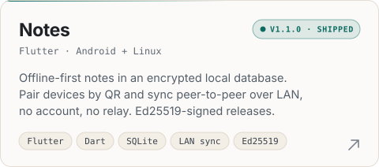
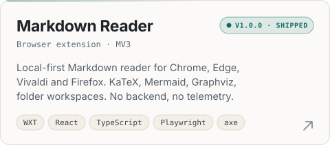
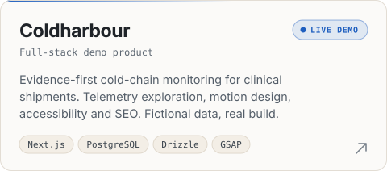
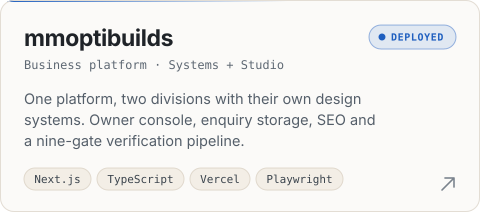
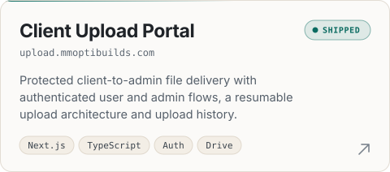
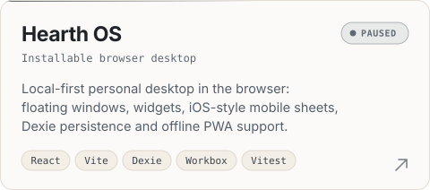
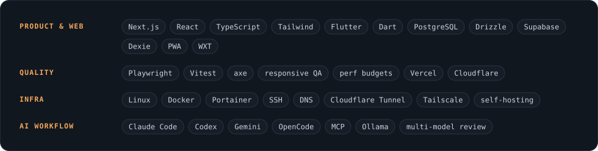

<picture>
  <source media="(prefers-color-scheme: dark)" srcset="./assets/header-dark.svg">
  <source media="(prefers-color-scheme: light)" srcset="./assets/header-light.svg">
  
</picture>

  
  
  
  
  

 

I'm **Mohammed Miran**, a BCA student in Bengaluru and the builder behind **mmoptibuilds**.

I work AI-first. I own the product, UX, architecture, specs and the verification loop, and I use coding agents to turn that direction into software that actually ships. Most of what I build is **local-first**: your data stays on your device, works offline, and doesn't need an account to be useful.

## Featured work

  
  

  
  

  
  

Also: <a href="https://github.com/mmoptibuilds-commits/portfolio-setup">Portfolio Setup</a>, my structured workflow for AI-assisted planning, implementation, QA and handoff.

## Stack

<picture>
  <source media="(prefers-color-scheme: dark)" srcset="./assets/stack-dark.svg">
  <source media="(prefers-color-scheme: light)" srcset="./assets/stack-light.svg">
  
</picture>

## How I build

- **Product first.** Nail the job, the constraints, the user journey and the quality bar before adding complexity.
- **AI-assisted, human-directed.** Agents implement. I own the product, the trade-offs, the review loop and final acceptance.
- **Verified, not vibes.** Type checks, tests, accessibility, responsive QA and real-browser runs are part of the build. Notes was signed off on real hardware, not just CI.
- **Low-maintenance wins.** Simple, proven architecture beats clever and fragile when the outcome is the same.
- **No fake claims.** Demo data is labelled as demo. Status pills above say exactly where each project stands.

## Now

- Shipping **Notes** updates and proving the signed in-app updater against a real published release.
- Building the **mmoptibuilds Studio + Systems** business platform.
- Tightening my agent workflow for planning, implementation, QA and deployment.
- **Hearth OS** is parked for now. The repo stays up as-is.

 

Building useful things where design, software, AI and infrastructure meet.

